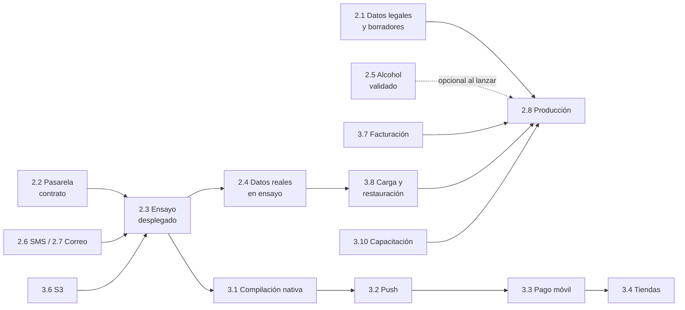

# Aquisito: guía de lo que falta implementar

**Fecha:** 2026-11-05 · **Estado de partida:** rama `main` (commit `66166d0`), CI en verde.

Aquí está todo lo que queda para pasar de "ejecutable local y validado en pruebas" a "operando con
pedidos reales". Cada tarea indica quién la hace, qué necesita, los pasos exactos y cómo comprobar
que quedó bien.

**Responsables:**
- **Titular**: el dueño del negocio o su representante (contratos, cuentas, datos legales).
- **Dev**: quien desarrolla, sea una persona o Claude.
- **Ops**: quien opera la infraestructura.

**Prioridades:**
- **P0**: sin esto no se puede operar con pedidos reales.
- **P1**: necesario para lanzar con calidad.
- **P2**: mejora posterior.

> Todo lo que depende de credenciales ya tiene el código escrito y está desactivado por
> configuración. En la mayoría de los casos solo hay que **configurar, probar en ensayo y activar**.
> Lo que requiere código nuevo se marca con **[código]**.

---

## Índice

1. [Resumen ejecutivo](#1-resumen-ejecutivo)
2. [P0 — Bloqueantes para operar](#2-p0--bloqueantes-para-operar)
3. [P1 — Necesarios para lanzar con calidad](#3-p1--necesarios-para-lanzar-con-calidad)
4. [P2 — Mejoras posteriores](#4-p2--mejoras-posteriores)
5. [Lista de verificación de lanzamiento](#5-lista-de-verificación-de-lanzamiento-26-del-encargo)
6. [Orden sugerido de ejecución](#6-orden-sugerido-de-ejecución)

---

## 1. Resumen ejecutivo

| # | Tarea | Prioridad | Responsable | ¿Requiere código? | Esfuerzo estimado |
|---|---|---|---|---|---|
| 2.1 | Datos legales del titular y revisión de borradores | P0 | Titular + asesoría | No | 1–3 semanas (externo) |
| 2.2 | Pasarela de pagos (Culqi u otra) | P0 | Titular + Dev | Ajustes menores | 2–5 días + trámite |
| 2.3 | Entorno de ensayo (staging) desplegado | P0 | Ops + Dev | Configuración | 2–4 días |
| 2.4 | Datos reales de operación (zonas, tarifas, comercios) | P0 | Titular + Ops | No | 1–2 semanas |
| 2.5 | Reglas de alcohol verificadas, o mantener alcohol cerrado | P0 | Titular + asesoría | No | Según trámite |
| 2.6 | SMS para acceso por teléfono, o desactivar OTP | P0 | Titular + Dev | No | 1–2 días |
| 2.7 | Correo transaccional | P0 | Dev | **Sí** (adaptador) | 1 día |
| 2.8 | Producción: despliegue, dominio, TLS, respaldos, monitoreo | P0 | Ops | Configuración | 3–5 días |
| 3.1 | Compilación nativa y prueba en dispositivos | P1 | Dev | Configuración | 2–4 días |
| 3.2 | Notificaciones push | P1 | Dev | Configuración | 1 día |
| 3.3 | Pago digital en apps móviles | P1 | Dev | **Sí** | 3–5 días |
| 3.4 | Publicación en Google Play / App Store | P1 | Titular + Dev | No | 1–3 semanas (revisión de tiendas) |
| 3.5 | Mapas y rutas para producción | P1 | Ops | Configuración | 1–2 días |
| 3.6 | Almacenamiento S3 privado | P1 | Ops | Configuración | 0.5 día |
| 3.7 | Facturación electrónica (SUNAT) | P1 | Titular + Dev | **Sí** | 1–2 semanas |
| 3.8 | Prueba de carga y restauración en ensayo | P1 | Ops + Dev | No | 1 día |
| 3.9 | Auditoría de accesibilidad y pruebas con usuarios locales | P1 | UX | Ajustes | 1 semana |
| 3.10 | Capacitación y procedimientos operativos | P1 | Titular | No | 1 semana |
| 4.x | Backlog técnico (tiempo real en móvil, Redis, imágenes de productos, etc.) | P2 | Dev | **Sí** | Variable |

---

## 2. P0 — Bloqueantes para operar

### 2.1 Datos legales del titular y revisión de borradores

**Por qué:** el Libro de Reclamaciones, los comprobantes, los términos y la política de privacidad
exigen identificar al proveedor del servicio. Hoy figuran como "por completar".

**Responsable:** Titular, con asesoría legal y contable.

**Pasos:**
1. Definir razón social, RUC, domicilio fiscal y representante legal.
2. Decidir si el nombre "Aquisito" se mantiene: verificar marca en INDECOPI y disponibilidad del dominio.
3. Revisar con asesoría y aprobar los borradores de `docs/legal-borradores.md`:
   - Términos y condiciones.
   - Política de privacidad (Ley N.° 29733 y D.S. N.° 016-2024-JUS).
   - Política de cancelación y devolución.
   - Política de venta responsable de alcohol (`docs/politica-edad.md`).
   - Condiciones operativas para repartidores.
   - Plazos de retención de datos (sección 6).
4. Inscribir el banco de datos personales ante la ANPD, si corresponde.
5. Validar el modelo de intermediación (decisión N2 de `docs/decisiones.md`): quién vende, quién emite comprobante, cómo fluye el dinero.
6. Definir contratos con comercios (comisión, liquidación, responsabilidades) y con repartidores (independientes o no, seguros).

**Cambios en el repositorio (Dev):**
- Reemplazar en `apps/web/app/legal/page.tsx` los borradores por los textos aprobados y subir la versión (`borrador-0.1` → `1.0`) en:
  - `apps/api/src/modules/identity/identity.service.ts` (consentimientos al registrarse).
  - `apps/api/src/modules/support/support.service.ts` (`politica-edad-0.1`).
  - La web (`policyVersion` de los consentimientos).
- Completar los datos del proveedor en `complaintCopy()` (`apps/api/src/modules/support/support.service.ts`) y en `apps/web/app/reclamaciones/page.tsx`.

**Verificación:** la constancia del Libro de Reclamaciones muestra razón social, RUC y domicilio; los consentimientos nuevos se guardan con la versión aprobada.

---

### 2.2 Pasarela de pagos (Culqi u otra)

**Estado actual:**
- `CulqiProvider` (`apps/api/src/providers/payments.ts`) está escrito y probado contra un servidor simulado local.
- El checkout web está escrito en `apps/web/components/culqi.tsx` y nunca se ejecutó.
- El simulador `sandbox` está prohibido fuera de desarrollo.

**Responsable:** Titular (contrato) y Dev (activación y pruebas).

**Pasos del Titular:**
1. Firmar el contrato de afiliación con Culqi (u otra pasarela) y pedir:
   - Llaves de **prueba** y de **producción** (`pk_…`, `sk_…`).
   - Habilitación de tarjetas y de billeteras (Yape/Plin) mediante órdenes de pago.
   - Confirmación escrita de **comisiones vigentes**: las cifras de blogs se contradicen (ver `docs/costos.md`).
   - Confirmación de si admite cobro centralizado con liquidación a terceros (modelo marketplace). Si no lo admite, se mantiene el esquema actual: la plataforma cobra y liquida por transferencia autorizada (ver `docs/finanzas.md`).
2. Configurar en el panel de Culqi la URL de webhook: `https://<api-ensayo>/webhooks/payments/culqi`.

**Pasos del Dev, en ensayo:**
1. Variables de entorno:
   ```
   PAYMENT_PROVIDERS=culqi
   CARD_PROVIDER=culqi
   WALLET_PROVIDER=culqi
   CULQI_SECRET_KEY=sk_test_...
   CULQI_PUBLIC_KEY=pk_test_...
   ```
2. Comparar con la documentación vigente de Culqi y ajustar si difieren:
   - Campos de `/charges`, `/orders` y `/refunds`.
   - Estados (`outcome.type`, `state`).
   - Forma del evento de webhook.
   - Opciones de Culqi Checkout v4 (`Culqi.settings`, `Culqi.options`, callback `culqi()`).
3. Actualizar el servidor simulado de `apps/api/test/providers.test.ts` para que refleje las respuestas reales observadas.
4. Probar en ensayo con tarjetas de prueba:
   - Pago aprobado y pago rechazado.
   - Yape/Plin en modo prueba.
   - Webhook repetido.
   - Reembolso total y parcial.
   - Respuesta incierta (cortar la red durante el cargo) seguida de conciliación.
5. Si Culqi ofrece una firma de webhook documentada, agregarla a `verifyWebhook` **además de** la consulta directa; no reemplazarla.

**Decisión de negocio pendiente (T19 en `docs/decisiones.md`):**
- Hoy un rechazo de tarjeta cancela el pedido y se ofrece "Volver a pedir".
- Si se prefiere reintentar sobre el mismo pedido **[código]**:
  - Agregar la transición `fallido → pendiente` en `packages/contracts/src/state-machines.ts`.
  - Permitir un nuevo intento de pago en `startPayment`.
  - Dejar de cancelar en `applyProviderResult` cuando falla un intento con tarjeta.

**Verificación:** las pruebas de aceptación A-11 a A-14 repetidas manualmente en ensayo con el proveedor real; el reembolso aparece confirmado en el panel de Culqi y en `/admin` › Pedidos › Detalle.

---

### 2.3 Entorno de ensayo (staging) desplegado

**Responsable:** Ops y Dev.

**Pasos:**
1. Elegir el proveedor de despliegue. Requisito: contenedores Docker y PostgreSQL 16 gestionado **con PostGIS**, respaldos automáticos y recuperación a un punto en el tiempo (PITR).
2. Crear una base de datos separada para ensayo y un bucket S3 privado (tarea 3.6).
3. Construir y publicar las imágenes:
   ```bash
   docker build -f infra/Dockerfile.api -t aquisito-api:<sha> .
   docker build -f infra/Dockerfile.web -t aquisito-web:<sha> .
   ```
4. Cargar las variables en el gestor de secretos del proveedor, a partir de `.env.example`, con `APP_ENV=staging`:
   - `DATA_ENCRYPTION_KEY`: generar con `openssl rand -base64 32`.
   - `COOKIE_SECURE=true`
   - `ALLOW_DEMO_SEED=false`
   - `STORAGE_DRIVER=s3`
   - Pagos con llaves de prueba (2.2), SMS real (2.6) y correo real (2.7).
5. Desplegar. El API aplica las migraciones al arrancar y **se niega a iniciar** si detecta simuladores, sembrado demo, claves faltantes o usuarios demo activos.
6. Crear el primer administrador sin datos demo **[código]**:
   - Hoy solo existe el sembrado demo, bloqueado fuera de desarrollo.
   - Crear `apps/api/src/db/bootstrap-admin-cli.ts`, que:
     - Reciba el correo por argumento.
     - Genere una contraseña temporal y un secreto TOTP.
     - Inserte el usuario con la membresía `admin`.
     - Imprima la contraseña y el secreto una sola vez.
     - Se pueda ejecutar solo si no existe ningún administrador.
7. Cargar los datos de operación (2.4) desde el panel o con un script de importación.
8. Apuntar `API_URL` de la web al API de ensayo y configurar `CORS_ORIGINS`.

**Verificación:**
- `GET /health` responde `ok` con la versión de PostGIS.
- `GET /metrics` responde para un administrador.
- Recorrer el circuito completo con cuentas de prueba reales; no existen cuentas demo.

---

### 2.4 Datos reales de operación

**Responsable:** Titular (definición) y Ops (carga desde el panel).

**Pasos:**
1. **Ciudades y jurisdicciones:**
   - Obtener los límites distritales oficiales (ubigeo).
   - Aguaytía: distrito de Padre Abad y vecinos aplicables.
   - Tingo María: Rupa-Rupa, Castillo Grande, Mariano Dámaso Beraún u otros según la cobertura.
   - **[código]** Hoy las jurisdicciones solo se crean por SQL o sembrado. Agregar `POST /admin/jurisdictions` con un GeoJSON, más su pantalla, o una migración de datos con las geometrías oficiales.
2. **Zonas de reparto:** dibujar los polígonos reales en `/admin` › Ciudades › Editar polígono. Cada cambio queda como versión nueva.
3. **Tarifas** (`/admin` › Ciudades › Tarifa de reparto): tarifa base, metros incluidos, precio por kilómetro, compra mínima, distancia máxima y pago al repartidor.
   - **[código]** El pago al repartidor (`courier_base_pay_cents`, `courier_per_km_cents`) hoy no se edita desde el formulario; agregar esos campos al esquema `FeeRuleInput` y a la pantalla.
4. **Tarifa de servicio por ciudad** (`cities.service_fee_cents`, hoy S/ 1.00 demo) y **tope de efectivo** (`cash_max_cents`):
   - **[código]** Agregarlos a `PATCH /admin/cities/:id`; hoy solo se cambian por SQL.
5. **Comercios:** cada comercio se registra en `/comercio/alta` con su cuenta propia.
   - El administrador revisa documentos y aprueba.
   - Registrar la comisión acordada en `/admin` › Finanzas.
6. **Repartidores:** postulan en `/repartidor/postular` y suben documentos. El administrador revisa, aprueba y registra la capacitación.
7. **Feriados:** completar `peru_holidays` con los feriados oficiales de 2027 y siguientes, incluidos los regionales si aplican.
   - **[código]** Opcional: pantalla o endpoint para mantenerlos.
8. **Cupones y banners** reales, con condiciones verificables.

**Verificación:**
- `POST /coverage/check` con direcciones reales de cada barrio devuelve la zona y jurisdicción esperadas.
- Una cotización devuelve la tarifa acordada.

---

### 2.5 Reglas de alcohol verificadas, o mantener alcohol cerrado

**Estado actual:**
- En ensayo y producción **solo cuentan reglas con `validated = true`**.
- Sin reglas validadas, la venta de alcohol queda cerrada automáticamente.
- Las reglas del sembrado son ficticias.

**Responsable:** Titular, con asesoría.

**Pasos:**
1. Obtener las ordenanzas vigentes:
   - Padre Abad (antecedente: 027-2015-MPPA-A).
   - Leoncio Prado (antecedente: 001-2009).
   - Distritos vecinos aplicables.
   - Verificar modificaciones y vigencia.
2. Por cada jurisdicción, registrar en `/admin` › Ciudades › Ventana de venta de alcohol:
   - Días y horas permitidas.
   - Fuente: número de ordenanza y enlace.
   - Fecha de revisión y responsable.
   - Marcar "validada" solo con la fuente confirmada.
3. Registrar las prohibiciones temporales conocidas (jornadas electorales, fechas especiales) en "Prohibición temporal".
4. Por cada comercio que venda alcohol:
   - Subir la autorización vigente (`/comercio` › Documentos).
   - El administrador la aprueba con su fecha de vencimiento.
   - El administrador habilita la venta en `/admin` › Comercios.
5. Activar `alcohol_enabled` por ciudad (`/admin` › Ciudades) solo después de los pasos 1 a 4.
6. Si se contrata un proveedor de verificación de identidad **[código]**:
   - Implementar un adaptador que registre `age_verifications` con `method = 'provider'` y `provider_reference`.
   - Mantener la revisión humana como alternativa.

**Verificación:**
- Con alcohol habilitado, una cotización fuera de horario devuelve `ALCOHOL_OUTSIDE_HOURS`.
- Con una prohibición activa devuelve `ALCOHOL_BLACKOUT`.

---

### 2.6 SMS para acceso por teléfono, o desactivar OTP

**Estado actual:** el adaptador de Twilio está escrito y probado contra un servidor simulado. En ensayo y producción `SMS_PROVIDER=console` impide arrancar.

**Opción A: activar SMS**
1. Titular: contratar el proveedor (Twilio u otro con cobertura en Perú) y obtener un remitente habilitado.
2. Variables: `SMS_PROVIDER=twilio`, `TWILIO_ACCOUNT_SID`, `TWILIO_AUTH_TOKEN`, `TWILIO_FROM`.
3. Si se elige otro proveedor **[código]**: crear una clase que implemente `SmsProvider` en `apps/api/src/providers/messaging.ts` y registrarla en `smsProvider()`.
4. Revisar el costo: las referencias de terceros dan ~US$0.13–0.23 por SMS a Perú (`docs/costos.md`).

**Opción B: lanzar sin OTP**
- **[código]** Agregar un valor `SMS_PROVIDER=disabled`:
  - Aceptarlo en `productionConfigProblems`.
  - Ocultar la pestaña "Teléfono (SMS)" en la web y la app.
- Hoy `requestOtp` ya responde `OTP_UNAVAILABLE` cuando no hay proveedor.

**Verificación:** solicitar y verificar un código desde un teléfono real; pasado el límite de solicitudes, el servidor devuelve `RATE_LIMITED`.

---

### 2.7 Correo transaccional [código]

**Estado actual:** solo existe el simulador `console`, válido únicamente en desarrollo. Fuera de desarrollo no se envían:
- Los enlaces de recuperación de contraseña.
- Las copias de las reclamaciones.

**Pasos (Dev):**
1. Elegir el proveedor (Amazon SES, Postmark, Resend u otro) y verificar el dominio (SPF, DKIM, DMARC).
2. En `apps/api/src/providers/messaging.ts`, crear la clase del proveedor que implemente `EmailProvider`.
   - Usar `fetch` a la API HTTP del proveedor; no hace falta una dependencia SMTP.
3. Registrarla en `emailProvider()` con `EMAIL_PROVIDER=<nombre>` y sus variables. Documentarlas en `.env.example`.
4. Agregar una prueba con servidor simulado, como en `apps/api/test/providers.test.ts`.
5. Plantillas mínimas:
   - Recuperación de contraseña.
   - Constancia del Libro de Reclamaciones.
   - Respuesta a una reclamación: hoy `respondComplaint` no envía correo; agregar el envío.

**Verificación:**
- La recuperación de contraseña llega al correo y el enlace vence a los 30 minutos.
- La constancia de una reclamación llega al consumidor.

---

### 2.8 Producción

**Responsable:** Ops.

**Pasos:**
1. Repetir 2.3 con `APP_ENV=production`, llaves de producción y una base de datos y un bucket propios.
2. Dominio y TLS:
   - Web: `https://<dominio>`.
   - API: `https://api.<dominio>` o detrás del mismo dominio.
   - `PUBLIC_WEB_URL`, `CORS_ORIGINS` y `COOKIE_SECURE=true`.
3. Proxy o CDN delante del API:
   - Límite de solicitudes global; el limitador actual es por proceso.
   - Compresión.
   - Cabeceras de seguridad (CSP para la web; incluir `checkout.culqi.com` si se usa Culqi).
4. Monitoreo y alertas sobre `/metrics` (ver `docs/despliegue.md`):
   - Eventos outbox fallidos.
   - Pagos en conciliación por más de 15 minutos.
   - Pedidos atascados.
   - p95 de respuesta mayor a 800 ms.
   - Falla de `/health`.
5. Respaldos:
   - Automáticos del proveedor.
   - `infra/scripts/backup.sh` diario hacia otra región.
   - Un ensayo de restauración mensual con `infra/scripts/restore-drill.sh`, adaptado con `SRC_DB` y credenciales.
6. Designar responsables operativos:
   - Soporte, despacho por ciudad y revisión de edad.
   - Finanzas: dos personas distintas para las liquidaciones (regla de cuatro ojos).
7. Procedimiento de despliegue y reversión: `docs/despliegue.md`. Migraciones solo hacia adelante.

**Verificación:** lista completa de la sección 5.

---

## 3. P1 — Necesarios para lanzar con calidad

### 3.1 Compilación nativa y prueba en dispositivos

**Estado actual:**
- Ambas apps compilan su código JavaScript para Android (`expo export`).
- No se compiló el APK/AAB: en el entorno donde se desarrolló, el proxy bloquea `dl.google.com` (Android SDK).

**Pasos (Dev, en una máquina con Android SDK, o con EAS Build):**
1. Crear la cuenta de Expo y el proyecto EAS:
   ```bash
   npx eas-cli login
   ```
   ```bash
   cd apps/courier-mobile && npx eas-cli init
   ```
   - Copiar el `projectId` en `app.json` › `expo.extra.eas.projectId` (hoy `null`).
   - Repetir en `apps/customer-mobile`.
2. Crear `eas.json` en cada app con perfiles `development`, `preview` (APK interno) y `production` (AAB) **[configuración]**.
3. Definir `EXPO_PUBLIC_API_URL` por perfil, apuntando al API de ensayo o producción.
4. Compilar:
   ```bash
   npx eas-cli build -p android --profile preview
   ```
   O localmente: `npx expo run:android`.
5. **Prueba de ubicación en segundo plano** (obligatoria antes de lanzar), en al menos 2 dispositivos Android de gama media y versiones distintas (por ejemplo Android 12 y 14):
   - Conceder "Permitir siempre" y activar la ubicación en segundo plano desde la app del repartidor.
   - Bloquear la pantalla 10 minutos durante una entrega simulada.
   - Verificar en `/admin` que `last_location_at` se actualiza.
   - Pasar la app a segundo plano y luego cerrarla desde recientes.
   - Activar el ahorro de batería y comprobar qué ocurre.
   - Registrar modelo, versión de Android, resultados y limitaciones en `docs/informe-pruebas.md`.
6. iOS (si se publica): compilar con `-p ios` y probar en un iPhone real. iOS puede pausar las actualizaciones; documentar el comportamiento observado.
7. Probar en el dispositivo:
   - Mapas en WebView.
   - Selección del punto de entrega.
   - Seguimiento.
   - Verificación de edad.
   - Flujo completo de entrega.

**Verificación:** el APK se instala; ambas apps completan el circuito contra el API de ensayo; el informe registra los dispositivos probados.

---

### 3.2 Notificaciones push

**Requisitos previos:** 3.1 (proyecto EAS y compilación nativa).

**Pasos:**
1. Android: crear el proyecto en Firebase, descargar `google-services.json` y configurar FCM en EAS (`eas credentials`).
2. iOS: llave APNs en EAS.
3. En el API: `PUSH_PROVIDER=expo` y `EXPO_ACCESS_TOKEN`.
4. En las apps ya existe el botón "Activar notificaciones", que registra el token en `POST /me/push-tokens`.
5. **[código]** Manejar los tokens inválidos que devuelve Expo:
   - Hoy `sendPush` no lee los recibos de entrega.
   - Leer los recibos y marcar `push_tokens.revoked_at` cuando el token quedó inválido (`DeviceNotRegistered`).

**Verificación:** un cambio de estado del pedido genera un push con texto genérico, sin detalles, en la pantalla bloqueada; `notifications.push_status = 'sent'`.

---

### 3.3 Pago digital en apps móviles [código]

**Estado actual:** en las apps móviles, tarjeta y billetera solo funcionan con el simulador (`mobileCheckout: false` para Culqi). Así la app no ofrece un pago que no se puede completar.

**Opciones:**
- **A.** Integrar el SDK móvil de Culqi para React Native, si existe y es mantenido, o su checkout en WebView con la llave pública.
- **B.** Abrir el checkout web en un navegador dentro de la app con un **enlace de pago de un solo uso**:
  - Endpoint nuevo `POST /payments/:orderId/checkout-link` que emita un token firmado con vencimiento corto.
  - Página web `/pagar/[token]` sin sesión, que abra Culqi Checkout y luego vuelva a la app mediante un *deep link*.

**Pasos con la opción B (recomendada, reutiliza el checkout web):**
1. API: tabla o token firmado (HMAC con `DATA_ENCRYPTION_KEY`) que contenga `orderId`, `userId` y vencimiento de 15 minutos; un endpoint que lo valide y devuelva lo mínimo para pagar.
2. Web: página `apps/web/app/pagar/[token]/page.tsx` que use `openCulqiCheckout`.
3. Apps: `expo-web-browser` para abrir el enlace; esquema `aquisito://` para volver.
4. Cambiar `mobileCheckout` a `true` en `publicPaymentsConfig()`.
5. Pruebas: enlace vencido, enlace reutilizado, pedido de otro usuario.

---

### 3.4 Publicación en tiendas

**Responsable:** Titular (cuentas, fichas, políticas) y Dev (compilación).

**Pasos:**
1. Crear las cuentas de desarrollador a nombre del titular:
   - Google Play: según fuentes de terceros, ~US$25 únicos.
   - Apple Developer: ~US$99 al año.
   - Verificar en las páginas oficiales.
2. Ajustar identificadores definitivos en `app.json`:
   - `android.package` e `ios.bundleIdentifier` (hoy `pe.aquisito.provisional.*`).
   - Nombre e íconos propios.
3. Google Play:
   - Formulario de **Seguridad de los datos**.
   - Declaración de **ubicación en segundo plano** (app del repartidor), con video del uso.
   - Política de privacidad publicada.
   - Clasificación de contenido: la app del cliente vende alcohol y requiere declaración y restricción de edad.
4. App Store: etiquetas de privacidad, justificación de `UIBackgroundModes: location`, cuenta de prueba para los revisores.
5. Pruebas cerradas antes de producción: Google exige una prueba cerrada con testers para cuentas nuevas; verificar los requisitos vigentes.

---

### 3.5 Mapas y rutas para producción

**Estado actual:** las teselas de OpenStreetMap público son solo para desarrollo. La distancia usa una aproximación en línea recta × 1.3, etiquetada como "aproximada".

**Pasos:**
1. Teselas: contratar un proveedor con cuota (MapTiler, Stadia, Mapbox) o un servidor propio.
   - Web: `NEXT_PUBLIC_MAP_TILE_URL` y `NEXT_PUBLIC_MAP_ATTRIBUTION`.
   - Apps: `app.json` › `extra.mapTileUrl`.
   - Revisar las condiciones de uso y atribución del proveedor.
2. Rutas: levantar un servidor OSRM con el extracto de Perú (Geofabrik). Luego `ROUTE_PROVIDER=osrm` y `OSRM_URL=http://osrm:5000`.
   - La interfaz deja de mostrar "aproximado" automáticamente.
3. Geocodificación (opcional) **[código]**: hoy el cliente marca el punto en el mapa. Para buscar direcciones escritas, agregar un adaptador (Nominatim propio u otro proveedor) en `apps/api/src/providers/geo.ts` y un endpoint de búsqueda.
4. **[código]** Las apps cargan Leaflet desde `unpkg.com`. Para no depender de un CDN público, empaquetar Leaflet como recurso local de la app.

---

### 3.6 Almacenamiento S3 privado

**Pasos:**
1. Crear un bucket **privado** con cifrado, bloqueo de acceso público y versión (opcional).
2. Variables: `STORAGE_DRIVER=s3`, `S3_BUCKET`, `S3_REGION`, `S3_ACCESS_KEY_ID`, `S3_SECRET_ACCESS_KEY` y, si no es AWS, `S3_ENDPOINT`.
3. Credenciales con permisos mínimos sobre ese bucket: `PutObject`, `GetObject` y `DeleteObject`.
4. Probar subida de documentos, enlace temporal de 5 minutos y borrado por el job de retención.
5. Política de ciclo de vida coherente con la retención aprobada (2.1).

---

### 3.7 Facturación electrónica (SUNAT) [código]

**Estado actual:** el pedido guarda el tipo de comprobante (boleta o factura), el documento y el nombre; **no se emite** ningún comprobante.

**Decisiones previas (Titular y contador):**
- Quién emite el comprobante de los productos (el comercio) y quién el del servicio (la plataforma: comisión, tarifa de servicio, reparto).
- Tratamiento de IGV, redondeos y notas de crédito por reembolsos.

**Pasos (Dev):**
1. Elegir un OSE o PSE autorizado con API.
2. Crear la interfaz `InvoiceProvider` en `apps/api/src/providers/invoicing.ts`: `emit`, `status`, `void`/nota de crédito.
3. Migración: tabla `invoices`, con:
   - `order_id`, `issuer` (plataforma o comercio), `type` y serie/correlativo.
   - Importes y estado (`pendiente`, `aceptado`, `rechazado`).
   - CDR, enlace al PDF/XML y `idempotency_key UNIQUE`.
4. Emitir por outbox al completar el pedido (`order.status_changed` → `completado`); emitir notas de crédito al confirmar reembolsos.
5. Pantallas:
   - Comprobantes en el detalle del pedido (cliente).
   - Reporte de comprobantes en `/admin` › Finanzas.
6. Pruebas con el entorno beta del proveedor.

> Un PDF generado internamente **no** es un comprobante aceptado por SUNAT.

---

### 3.8 Prueba de carga y restauración en ensayo

1. Ejecutar `infra/scripts/load-test.mjs` contra el API de ensayo, desde **otra máquina**:
   - Usar cuentas de prueba creadas para la carga (sin datos demo en ensayo).
   - Adaptar los correos del script o parametrizarlos **[código menor]**.
2. Registrar en `docs/informe-pruebas.md` las cifras p50 y p95 por operación, excluyendo la latencia de proveedores externos.
3. Ensayo de restauración sobre la base de ensayo con `restore-drill.sh` y `SRC_DB` apuntando a ella.
4. Si alguna p95 supera 800 ms:
   - Revisar índices con `EXPLAIN ANALYZE`.
   - Considerar caché pública del catálogo (solo datos no privados).

---

### 3.9 Accesibilidad y pruebas con usuarios locales

1. Auditoría con lector de pantalla (TalkBack en Android, NVDA en la web) y navegación solo con teclado.
2. Revisión automática (axe/Lighthouse) de las páginas principales.
3. Pruebas con 5 a 8 usuarios por ciudad (clientes, comercios, repartidores) en teléfonos de gama media y conexión móvil real; registrar hallazgos y corregir.
4. Revisar textos y términos locales con usuarios de Aguaytía y Tingo María.

---

### 3.10 Capacitación y procedimientos operativos

1. Capacitar a los repartidores con `docs/manuales.md` (venta responsable, verificación de edad, rechazo, privacidad, efectivo) y registrar la capacitación en `/admin` › Repartidores.
2. Procedimiento escrito de verificación de edad por videollamada (`docs/politica-edad.md` §3): guion, evidencia mínima, tiempos.
3. Turnos de soporte y despacho por ciudad; plazos de respuesta.
4. Procedimiento de conciliación diaria (pagos en conciliación, reembolsos pendientes, efectivo por rendir) y de liquidación semanal (cuatro ojos).
5. Procedimiento ante incidentes de seguridad y de datos personales.

---

## 4. P2 — Mejoras posteriores

| # | Mejora | Detalle técnico |
|---|---|---|
| 4.1 | Tiempo real en las apps móviles | Hoy consultan cada 8–10 s. Agregar SSE con `react-native-sse` o WebSocket; mantener la consulta al reconectar. |
| 4.2 | Limitador de solicitudes distribuido | Hoy es por proceso. Con varias instancias, usar Redis o el límite del proxy/CDN. |
| 4.3 | Redis y cola de trabajos | Solo si la carga lo justifica (decisión T5). Hoy alcanza con PostgreSQL (outbox + `SKIP LOCKED`). |
| 4.4 | Imágenes de productos | Subida a un bucket **público** separado o CDN, con redimensionamiento (`sharp`), formato WebP y variantes; el comercio sube la foto desde el catálogo. Mantener la marca "imagen demostrativa" en los datos demo. |
| 4.5 | Más de una entrega por repartidor | Hoy la capacidad es 1 (índice único). Rutas con varias paradas requieren cambiar `deliveries_one_active_per_courier` y la lógica de ofertas. |
| 4.6 | Reasignación automática | Si el repartidor pierde conexión o no avanza en X minutos antes del recojo, liberar y volver a ofertar (job nuevo). |
| 4.7 | Cobro diferido en pedidos programados | Hoy se cobra al confirmar (decisión N9). Requiere preautorización si el proveedor la soporta (estado `autorizado`). |
| 4.8 | Transferencia bancaria manual | Ya implementada y desactivada (`TRANSFER_PAYMENTS_ENABLED`). Activarla requiere un procedimiento de conciliación diaria. |
| 4.9 | Mantenimiento de jurisdicciones y feriados desde el panel | Endpoints y pantallas (ver 2.4). |
| 4.10 | Reportes adicionales | Exportación de liquidaciones y del libro con zona horaria y filtros; tablero por sucursal. |
| 4.11 | Chat en tiempo real | Los mensajes del pedido existen y se actualizan por SSE en la web; en móvil, por consulta periódica. |
| 4.12 | Observabilidad | Exportar métricas a Prometheus/OpenTelemetry; trazas con `correlationId`. |
| 4.13 | Pruebas E2E móviles | Detox o Maestro sobre la compilación nativa. |
| 4.14 | Accesibilidad móvil | Etiquetas en todos los controles y tamaños de fuente dinámicos. |
| 4.15 | Actualizar dependencias | Next 16, NestJS 12, Expo SDK posterior, TypeScript 7: una versión mayor por vez con la suite completa (decisión T2). |

---

## 5. Lista de verificación de lanzamiento (§26 del encargo)

Marcar cada punto con evidencia (enlace, fecha, responsable). No marcar sin evidencia.

| Ítem | Estado al 2026-11-05 | Evidencia requerida |
|---|---|---|
| Nombre comercial y dominio verificados | ☐ Pendiente | Búsqueda en INDECOPI y registro del dominio |
| Responsable del negocio, razón social, RUC | ☐ Pendiente | Documento constitutivo y ficha RUC |
| Contratos con comercios | ☐ Pendiente | Modelo firmado por cada comercio |
| Contratos con repartidores | ☐ Pendiente | Modelo firmado |
| Cobertura real cargada | ☐ Pendiente | Polígonos versionados en el panel; pruebas de cobertura |
| Horarios y permisos de alcohol verificados, o alcohol cerrado | ☐ Pendiente (cerrado por defecto) | Reglas validadas con fuente; documentos aprobados |
| Catálogo y stock reales | ☐ Pendiente | Comercios aprobados con catálogo |
| Tarifas y comisiones | ☐ Pendiente | Reglas cargadas; contratos |
| Cuenta de pasarela de pagos activa | ☐ Pendiente | Llaves de producción; prueba en ensayo |
| Políticas revisadas (términos, privacidad, alcohol, cancelación) | ☐ Pendiente | Aprobación de la asesoría; versión 1.0 publicada |
| Libro de Reclamaciones con datos del proveedor | ☐ Pendiente | Constancia de prueba con razón social |
| Atención al consumidor (turnos, plazos) | ☐ Pendiente | Procedimiento escrito |
| Seguridad (TLS, secretos, MFA admin, proxy) | 🟡 Código listo | Revisión de configuración en producción |
| Respaldos y restauración | 🟡 Ensayo local hecho | Ensayo de restauración en la base de producción o ensayo |
| Monitoreo y alertas | 🟡 Métricas expuestas | Alertas configuradas y probadas |
| Responsables operativos designados | ☐ Pendiente | Lista con nombres y turnos |
| Apps publicadas (opcional al inicio: web instalable) | ☐ Pendiente | Fichas aprobadas en las tiendas |
| Datos demo ausentes en producción | ✅ Garantizado por código | El API no arranca con usuarios demo |

**Etapas de habilitación:**
1. **Ejecutable local**: ✅ hecho.
2. **Validado en pruebas**: ✅ hecho; 73 pruebas automatizadas y CI en verde.
3. **Desplegado en ensayo**: ☐ tareas 2.2 a 2.4 y 2.6 a 2.7, más 2.3.
4. **Habilitado para operación real**: ☐ todo lo anterior, más la lista de esta sección.

---

## 6. Orden sugerido de ejecución



1. **Semana 1:** 2.1 (iniciar trámites), 2.2 (contrato), 2.7 (correo), 3.6 (S3), elegir proveedor de despliegue.
2. **Semana 2:** 2.3 ensayo desplegado con pagos de prueba, SMS y correo; 2.4 carga de datos en ensayo; 3.1 compilación nativa.
3. **Semana 3:** 3.8 carga y restauración; 3.2 push; 3.3 pago móvil; 3.9 pruebas con usuarios; 3.10 capacitación.
4. **Semana 4 en adelante:**
   - 3.7 facturación.
   - 2.8 producción.
   - Lanzamiento piloto **sin alcohol**.
   - 3.4 tiendas.
   - 2.5 alcohol cuando las reglas estén validadas.
