# Documento de análisis del sistema: Aquisito

| | |
|---|---|
| **Sistema** | Aquisito (nombre provisional): plataforma de delivery multicomercio |
| **Ámbito** | Aguaytía (Padre Abad, Ucayali) y Tingo María (Leoncio Prado, Huánuco), Perú |
| **Versión del documento** | 1.0, 2026-11-05 |
| **Versión del sistema** | rama `main`, commit `66166d0` |
| **Audiencia** | Analistas de sistemas, líderes técnicos, auditoría, titular del negocio |
| **Documentos relacionados** | `decisiones.md`, `estados.md` (generado), `openapi.json` (generado), `finanzas.md`, `politica-edad.md`, `trazabilidad.md`, `informe-pruebas.md`, `PENDIENTES.md` |

> Este documento describe el sistema **tal como está implementado**. Lo que aún no está
> implementado o depende de terceros se marca como **[pendiente]** y se detalla en `PENDIENTES.md`.

---

## Índice

1. [Introducción](#1-introducción)
2. [Contexto del sistema y actores](#2-contexto-del-sistema-y-actores)
3. [Requisitos funcionales](#3-requisitos-funcionales)
4. [Requisitos no funcionales](#4-requisitos-no-funcionales)
5. [Reglas de negocio](#5-reglas-de-negocio)
6. [Casos de uso](#6-casos-de-uso)
7. [Procesos y diagramas de secuencia](#7-procesos-y-diagramas-de-secuencia)
8. [Ciclos de vida (diagramas de estado)](#8-ciclos-de-vida-diagramas-de-estado)
9. [Modelo de datos](#9-modelo-de-datos)
10. [Matriz de permisos](#10-matriz-de-permisos)
11. [Arquitectura](#11-arquitectura)
12. [Interfaces y eventos](#12-interfaces-y-eventos)
13. [Inventario de pantallas](#13-inventario-de-pantallas)
14. [Seguridad, privacidad y auditoría](#14-seguridad-privacidad-y-auditoría)
15. [Calidad y verificación](#15-calidad-y-verificación)
16. [Glosario](#16-glosario)

---

## 1. Introducción

### 1.1 Propósito
Aquisito conecta a **clientes** con **comercios locales** (restaurantes, minimarkets, bodegas) y
con **repartidores** independientes, en dos ciudades que operan por separado.

Este documento especifica:
- Qué hace el sistema: requisitos y casos de uso.
- Bajo qué reglas lo hace: negocio, inventario, pagos, alcohol.
- Con qué datos: modelo entidad-relación.
- Quién puede hacer cada cosa: matriz de permisos.
- Cómo está construido: arquitectura e interfaces.

### 1.2 Alcance

**Incluye:**
- Descubrimiento de comercios y catálogo.
- Carrito y cotización.
- Pedido inmediato o programado.
- Pago digital (simulado en desarrollo; Culqi [pendiente]) y en efectivo.
- Gestión del pedido por el comercio, despacho y entrega.
- Venta restringida de alcohol con verificación de edad.
- Promociones (cupones, combos, banners).
- Soporte: incidencias, mensajes y Libro de Reclamaciones.
- Libro contable, liquidaciones y rendición de efectivo.
- Administración por ciudad, auditoría y derechos sobre datos personales.

**No incluye:**
- Transporte entre ciudades.
- Billetera con custodia de fondos.
- Pagos divididos automáticos.
- Emisión de comprobantes SUNAT [pendiente].
- Verificación de identidad contra RENIEC.

### 1.3 Supuestos
Ver `decisiones.md`. Los principales:
- Modelo intermediario: el comercio vende y la plataforma cobra comisión, servicio y reparto.
- Una sucursal por pedido.
- Precios, tarifas, polígonos y horarios de demostración ficticios.
- Moneda PEN en céntimos enteros.
- Instantes guardados en UTC y reglas evaluadas en `America/Lima`.

---

## 2. Contexto del sistema y actores

### 2.1 Diagrama de contexto

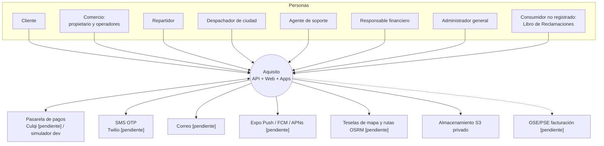

### 2.2 Actores

| Actor | Rol técnico | Ámbito | Descripción |
|---|---|---|---|
| Visitante | (sin sesión) | — | Navega ciudades, comercios y catálogo no restringido; registra reclamaciones. |
| Cliente | `customer` (implícito en toda cuenta) | Sus datos y pedidos | Compra, paga, sigue, cancela, reporta y valora. |
| Propietario de comercio | `merchant_owner` | Todas las sucursales de su comercio | Gestiona pedidos, catálogo, combos, horarios, documentos y operadores; ve ventas y liquidaciones. |
| Operador de sucursal | `branch_operator` | Una sucursal | Gestiona pedidos y catálogo de su sucursal, con cuenta propia. |
| Repartidor | `courier` | Su ciudad; solo pedidos asignados | Recibe ofertas, recoge, entrega y verifica edad; ve sus ingresos. |
| Despachador de ciudad | `city_dispatcher` | Una ciudad | Supervisa pedidos, asigna y reasigna, aprueba repartidores, suspende zonas. |
| Agente de soporte | `support_agent` | Global o por ciudad | Incidencias, cancelaciones supervisadas, reembolsos, reclamaciones, cola de edad (lectura). |
| Responsable financiero | `finance` (exige TOTP) | Global | Conciliación, reembolsos manuales, liquidaciones, rendición de efectivo, comisiones. |
| Administrador | `admin` (exige TOTP) | Global | Configuración: ciudades, zonas, tarifas, reglas de alcohol, comercios, documentos, roles, banners, cupones, datos personales. |
| Sistema | `system` | — | Jobs: vencimientos, despacho automático, conciliación, reembolsos, outbox, retención. |
| Proveedor de pagos | `payment_provider` | — | Confirma cobros y reembolsos por webhook o consulta. |

Una persona puede tener varias membresías (por ejemplo, cliente y repartidor). Cada acción se
autoriza con el rol **y** el ámbito correspondiente.

---

## 3. Requisitos funcionales

Prioridad: **M** (obligatorio) o **D** (deseable).

Estado:
- **I**: implementado.
- **IP**: implementado y cubierto por prueba automática.
- **B**: bloqueado por un tercero.
- **P**: pendiente.

### 3.1 Identidad y acceso (IDN)

| ID | Requisito | Prior. | Estado |
|---|---|---|---|
| RF-IDN-01 | Registro con correo, contraseña (mín. 10 caracteres) y nombre; consentimientos de términos y privacidad con versión. | M | IP |
| RF-IDN-02 | Acceso por correo y contraseña con bloqueo temporal tras 5 intentos fallidos en 15 min. | M | IP |
| RF-IDN-03 | Acceso por teléfono con OTP de 6 dígitos: vence en 5 min, máx. 5 intentos, máx. 3 solicitudes por teléfono cada 15 min y 10 por IP por hora. | M | IP (SMS real: B) |
| RF-IDN-04 | Segundo factor TOTP obligatorio para operaciones de administración y finanzas; un código no se reutiliza. | M | IP |
| RF-IDN-05 | Listar sesiones o dispositivos y revocar cualquiera; cerrar sesión. | M | IP |
| RF-IDN-06 | Recuperar la contraseña con enlace de un solo uso (30 min); revoca todas las sesiones. | M | I (correo: B) |
| RF-IDN-07 | Perfil editable; cambiar nombre o fecha de nacimiento revoca la verificación de edad. | M | IP |
| RF-IDN-08 | Direcciones con punto confirmado en el mapa, referencia e instrucciones; indicador de cobertura. | M | IP |
| RF-IDN-09 | Consentimientos por finalidad (marketing, marketing de alcohol, ubicación) con versión y fecha. | M | I |
| RF-IDN-10 | Solicitudes ARCO y eliminación de cuenta con plazo; la eliminación anonimiza y conserva registros obligatorios. | M | IP |

### 3.2 Geografía y cobertura (GEO)

| ID | Requisito | Prior. | Estado |
|---|---|---|---|
| RF-GEO-01 | Seleccionar la ciudad manualmente o sugerirla por ubicación, con permiso. | M | I |
| RF-GEO-02 | Validar la cobertura en el servidor: el punto debe estar en una zona vigente de la misma ciudad y en una jurisdicción registrada. | M | IP |
| RF-GEO-03 | Rechazar pedidos entre ciudades distintas. | M | IP |
| RF-GEO-04 | Zonas con polígonos versionados y editables en el mapa. | M | I |
| RF-GEO-05 | Suspender zonas temporalmente (lluvia, bloqueo vial, falta de capacidad) con vigencia y motivo. | M | IP |
| RF-GEO-06 | Pausar la operación de una ciudad o sucursal sin borrar el historial. | M | I |
| RF-GEO-07 | Tarifa por ciudad, zona o sucursal: base, metros incluidos, precio por km, mínimo, recargo y distancia máxima. | M | IP |

### 3.3 Catálogo (CAT)

| ID | Requisito | Prior. | Estado |
|---|---|---|---|
| RF-CAT-01 | Listar comercios por ciudad con estado abierto o cerrado y motivo, costo de envío, tiempo estimado, mínimo y valoración. | M | IP |
| RF-CAT-02 | Filtros por categoría, "solo abiertos" y orden por tiempo o costo; búsqueda por comercio y producto. | M | I |
| RF-CAT-03 | Producto con variantes, adicionales (mín./máx.), notas, disponibilidad y precio final. | M | IP |
| RF-CAT-04 | Distinguir platos preparados (sin inventario) y artículos con stock físico por SKU con unidad explícita. | M | IP |
| RF-CAT-05 | Combos con componentes, cantidades, variantes elegibles, vigencia, horario, cupo y límite por cliente; ahorro contra precio de referencia comprobable. | M | IP |
| RF-CAT-06 | Contenido con alcohol oculto en catálogo, búsqueda, enlaces directos y banners para cuentas no verificadas. | M | IP |
| RF-CAT-07 | Favoritos y recompra. | D | I |
| RF-CAT-08 | Banners con condiciones visibles. | D | IP |

### 3.4 Pedidos (PED)

| ID | Requisito | Prior. | Estado |
|---|---|---|---|
| RF-PED-01 | Carrito en el servidor con una sola sucursal; reemplazarlo exige confirmación. | M | IP |
| RF-PED-02 | Cotización con identificador, versión, desglose y vencimiento (10 min). | M | IP |
| RF-PED-03 | Confirmación idempotente con cabecera `Idempotency-Key`; un doble clic no duplica. | M | IP |
| RF-PED-04 | Si el total cambia entre la cotización y la confirmación, no se crea el pedido y se devuelve una nueva versión para aceptar. | M | IP |
| RF-PED-05 | Pedidos programados por franjas con capacidad. | M | IP |
| RF-PED-06 | Seguimiento con cronología, ETA, repartidor y ubicación vigente o marcada como desactualizada. | M | IP |
| RF-PED-07 | Cancelación del cliente antes de la aceptación del comercio, con reembolso. | M | IP |
| RF-PED-08 | Código de entrega de un solo uso, visible solo para el comprador. | M | IP |
| RF-PED-09 | Mensajes dentro del pedido; incidencias con evidencia; valoración solo de pedidos completados. | M | I/IP |
| RF-PED-10 | Faltantes: el comercio propone retirar o sustituir; el cliente acepta o rechaza; se reembolsa la diferencia. | M | IP |
| RF-PED-11 | Cupones por ciudad, comercio y categoría, con fechas, mínimo, presupuesto, usos y límite por usuario. | M | IP |

### 3.5 Comercio (COM)

| ID | Requisito | Prior. | Estado |
|---|---|---|---|
| RF-COM-01 | Solicitud de alta con datos comerciales y sucursal; se publica tras la aprobación administrativa. | M | I |
| RF-COM-02 | Bandeja en tiempo real con aviso sonoro opcional: aceptar o rechazar con motivo, iniciar preparación, ajustar ETA, marcar listo. | M | IP |
| RF-COM-03 | Plazo de aceptación; vencido, el sistema rechaza y reembolsa. | M | IP |
| RF-COM-04 | Catálogo, precios, stock con motivo, combos, horarios (incluso cruzando medianoche), cierres especiales y pausa. | M | IP/I |
| RF-COM-05 | Operadores con cuenta propia. | M | IP |
| RF-COM-06 | Comanda imprimible; reporte de ventas, comisiones y cancelaciones; CSV con zona horaria y filtros; liquidaciones. | M | I |
| RF-COM-07 | Documentos con vencimiento; inspección de devoluciones antes de reponer stock. | M | IP |

### 3.6 Reparto (REP)

| ID | Requisito | Prior. | Estado |
|---|---|---|---|
| RF-REP-01 | Postulación: 18+, vehículo, términos y consentimiento de ubicación; activación tras revisión manual. | M | I |
| RF-REP-02 | Disponibilidad y ubicación con precisión y marca de tiempo; ubicación en segundo plano en la app nativa. | M | IP (dispositivo: B) |
| RF-REP-03 | Ofertas sin datos personales: zona de destino, distancia, pago estimado, alcohol y efectivo; vencimiento de 60 s; aceptación atómica. | M | IP |
| RF-REP-04 | Recojo con código y número de paquetes; entrega con código de 4 dígitos (máx. 5 errores por hora). | M | IP |
| RF-REP-05 | Verificación presencial de edad obligatoria para alcohol; rechazo con motivo. | M | IP |
| RF-REP-06 | Entrega fallida (ausente, dirección incorrecta, accidente, avería) y retorno al comercio. | M | I |
| RF-REP-07 | Ganancias, propinas, efectivo por rendir e historial sin dirección exacta. | M | IP |

### 3.7 Administración y despacho (ADM)

| ID | Requisito | Prior. | Estado |
|---|---|---|---|
| RF-ADM-01 | Indicadores por ciudad con definiciones documentadas (`indicadores.md`). | M | I |
| RF-ADM-02 | Pedidos activos con filtros; asignación manual y reasignación con motivo e historial. | M | IP |
| RF-ADM-03 | Aprobar comercios y repartidores; revisar documentos; habilitar alcohol por sucursal. | M | IP |
| RF-ADM-04 | Cola de verificación de edad por revisión humana. | M | IP |
| RF-ADM-05 | Reglas de alcohol por jurisdicción con fuente, fecha de revisión y responsable; prohibiciones temporales. | M | IP |
| RF-ADM-06 | Cupones, banners y comisiones con vigencia. | M | I/IP |
| RF-ADM-07 | Incidencias con resolución económica por concepto; Libro de Reclamaciones con plazo y alertas. | M | IP |
| RF-ADM-08 | Roles: otorgar y revocar con motivo. | M | I |
| RF-ADM-09 | Auditoría y cola de eventos con fallos visibles. | M | I |
| RF-ADM-10 | Exportación CSV protegida, sin datos personales. | M | I |

### 3.8 Finanzas (FIN)

| ID | Requisito | Prior. | Estado |
|---|---|---|---|
| RF-FIN-01 | Libro de movimientos inmutable con asientos por pedido, reembolso y rendición. | M | IP |
| RF-FIN-02 | Liquidaciones reproducibles por tercero y período, sin incluir dos veces un movimiento. | M | IP |
| RF-FIN-03 | Cuatro ojos: aprueba una persona distinta de quien generó; la ejecución registra una referencia externa. | M | IP |
| RF-FIN-04 | Conciliación de pagos inciertos o pendientes contra el proveedor. | M | IP |
| RF-FIN-05 | Reembolsos idempotentes; los de pasarela se confirman solo con el proveedor y los manuales solo para efectivo o transferencia. | M | IP |
| RF-FIN-06 | Rendición de efectivo del repartidor por el total pendiente. | M | IP |
| RF-FIN-07 | Comprobantes electrónicos SUNAT. | M | P |

### 3.9 Notificaciones (NOT)

| ID | Requisito | Prior. | Estado |
|---|---|---|---|
| RF-NOT-01 | Notificaciones internas persistentes por cambios de estado, ofertas, faltantes, proximidad, edad, reclamaciones y permisos. | M | IP |
| RF-NOT-02 | Texto genérico en la pantalla bloqueada, sin productos, montos ni alcohol. | M | IP |
| RF-NOT-03 | Push a dispositivos registrados. | M | B |
| RF-NOT-04 | Tiempo real en la web (SSE) con recuperación consultando la API. | M | I |

---

## 4. Requisitos no funcionales

| ID | Categoría | Requisito | Cómo se cumple o verifica |
|---|---|---|---|
| RNF-01 | Rendimiento | p95 < 800 ms en consultas habituales con 100 sesiones y ~20 pedidos/min (supuesto de piloto). | `infra/scripts/load-test.mjs`: medido en local (`informe-pruebas.md`); en ensayo [pendiente]. |
| RNF-02 | Integridad | Sin sobreventa, sin doble asignación, sin doble cobro y sin doble liquidación, incluso con concurrencia. | UPDATE condicionales, índices únicos parciales, `FOR UPDATE`, advisory locks; pruebas A-07, A-10, A-11, A-24, A-25 con PostgreSQL real. |
| RNF-03 | Consistencia | La confirmación y el inventario dependen de transacciones en PostgreSQL, no de cachés. | Transacciones READ COMMITTED con reintento ante deadlock. |
| RNF-04 | Disponibilidad | Recuperación ante fallas sin perder eventos. | Patrón outbox con reintentos exponenciales y cola de fallos; jobs coordinados con advisory lock. |
| RNF-05 | Respaldo | Respaldo lógico con checksum; restauración verificada. Propuesta: RPO 24 h (lógico) o minutos (PITR del proveedor); RTO < 4 h. | `backup.sh`, `restore.sh`, `restore-drill.sh` (ensayo local OK). |
| RNF-06 | Seguridad | Autorización en el servidor por rol y ámbito; 404 en lugar de 403 para recursos ajenos. | Guard global y comprobaciones de ámbito; pruebas A-04, A-05, A-26. |
| RNF-07 | Seguridad | Contraseñas con scrypt; sesiones opacas con hash, revocables; cookie httpOnly y CSRF de doble envío; TOTP. | `common/crypto.ts`, `common/auth.ts`. |
| RNF-08 | Privacidad | Logs sin tokens, ubicación ni documentos; archivos privados con enlaces de 5 min; ubicación solo durante el pedido activo. | Redacción de logs (A-26); `storage.ts`; `tracking()`. |
| RNF-09 | Compatibilidad | Android de gama media y conexión variable; web adaptable e instalable. | PWA sin caché de datos privados; bundles móviles de ~2.6 MB. |
| RNF-10 | Conectividad | Avisar la desconexión; nunca confirmar pagos, inventario ni entregas solo en el dispositivo. | Banner sin conexión; E2E-4. |
| RNF-11 | Accesibilidad | Contraste AA, foco visible, objetivos táctiles ≥ 42 px, roles ARIA. | `diseno.md` (contrastes calculados); auditoría con usuarios [pendiente]. |
| RNF-12 | Localización | Español peruano, PEN como "S/", zona `America/Lima`. | `formatPEN`, `localDate`, reglas por zona horaria. |
| RNF-13 | Observabilidad | Health check, métricas (p50/p95/p99, errores, colas, pagos inciertos, pedidos atascados), `correlationId`. | `/health`, `/metrics`, cabecera `x-correlation-id`. |
| RNF-14 | Configuración segura | Producción rechaza simuladores, sembrado demo, claves faltantes y usuarios demo. | `productionConfigProblems`; A-30; arranque verificado. |
| RNF-15 | Mantenibilidad | Contratos únicos (zod) compartidos por API, web y móvil; OpenAPI generado; registro de endpoints igual a las rutas. | Prueba `routes.test.ts`; CI en GitHub Actions. |
| RNF-16 | Escalabilidad | Monolito modular sin estado de sesión en memoria; varias instancias posibles. | Jobs con advisory lock; SSE vía LISTEN/NOTIFY. Limitador distribuido [pendiente]. |

---

## 5. Reglas de negocio

### 5.1 Cobertura y tarifas
- **RN-01** Un pedido requiere: dirección y sucursal en la **misma ciudad**; punto de entrega dentro de una **versión vigente** de una zona activa; zona sin suspensión; ciudad activa; punto dentro de una jurisdicción registrada.
- **RN-02** Envío = `base + ceil(décimas de km sobre lo incluido × precio_km / 10) + recargo`. Distancia por ruta OSRM o aproximación `haversine × 1.3`, etiquetada "aproximada".
- **RN-03** Se rechaza si la distancia supera el máximo de la regla o el subtotal no alcanza la compra mínima.
- **RN-04** Se aplica la regla más específica: sucursal, luego zona, luego ciudad; entre iguales, la más reciente.
- **RN-05** ETA = preparación + recorrido (o distancia / 300 m/min) + 15 min de margen. Es una estimación, no una promesa.

### 5.2 Comercio abierto
- **RN-06** Abierto = comercio aprobado + sucursal activa + ciudad activa + sin pausa + sin cierre especial vigente + dentro de alguna franja semanal (hora de Lima). Una franja con cierre ≤ apertura cruza la medianoche.

### 5.3 Precios y carrito
- **RN-07** Todos los importes se calculan en el servidor; los valores enviados por el cliente se ignoran.
- **RN-08** Precio de línea = (precio de variante + adicionales) × cantidad. Los adicionales deben pertenecer al producto y respetar el mínimo y máximo de cada grupo.
- **RN-09** Combos: cada componente exige una opción elegida (automática si hay una sola). El combo debe estar dentro de su período y horario, con cupo y sin superar el límite por cliente.
- **RN-10** Demanda **agregada** por SKU = unidades sueltas + componentes de combos + adicionales con SKU. Disponible = `on_hand − reserved`.
- **RN-11** Descuento de cupón ≤ subtotal (más envío si es "envío gratis") y ≤ presupuesto restante. Se reparte por línea con el método del mayor resto. Total ≥ 0.

### 5.4 Confirmación, inventario y cancelación
- **RN-12** La cotización vence a los 10 minutos. Al confirmar se recalcula todo y, si cambia cualquier importe o la condición de alcohol, se devuelve `QUOTE_CHANGED` con versión + 1.
- **RN-13** Una cotización genera como máximo un pedido; una clave de idempotencia por usuario genera un pedido.
- **RN-14** Al confirmar, en la misma transacción: reserva de stock, uso de cupón, reserva de franja y consumo del cupo del combo. Si algo falla, nada queda registrado.
- **RN-15** Pago digital: el pedido queda `pendiente_confirmacion` hasta que el proveedor confirma (plazo de 15 min). **Efectivo**: el pedido queda `confirmado` y el pago `pendiente` hasta el cobro.
- **RN-16** El stock sale definitivamente al iniciar la preparación. Una devolución vuelve a stock vendible **solo** si el comercio lo indica al inspeccionar, y una sola vez.
- **RN-17** El cliente cancela solo antes de la aceptación del comercio. Después cancela soporte, con motivo.
- **RN-18** Al cancelar o rechazar: se liberan reservas, se revierten cupón, franja y cupo, y se reembolsa lo cobrado.

### 5.5 Pagos
- **RN-19** Un pedido tiene a lo sumo **un pago "vivo"** (índice único parcial).
- **RN-20** Un evento del proveedor se aplica solo si:
  - Su autenticidad está verificada (firma o consulta directa).
  - No está duplicado.
  - Importe, moneda y referencia coinciden; si no, el pago pasa a conciliación.
- **RN-21** `pagado` no se revierte por un evento "fallido" posterior.
- **RN-22** Respuesta incierta: el pago pasa a `en_conciliacion` y no se crea un nuevo cargo hasta consultar al proveedor.
- **RN-23** Al vencer el plazo, primero se consulta al proveedor; si no hay cobro, se cancela. Un pago tardío genera devolución automática.
- **RN-24** Rechazo con tarjeta: el pedido se cancela y se ofrece "Volver a pedir" (decisión T19).

### 5.6 Despacho y entrega
- **RN-25** Candidatos a una oferta:
  - Repartidor aprobado, disponible, de la misma ciudad y con ubicación de menos de 10 minutos.
  - Sin entrega activa ni oferta abierta, y sin haber rechazado ese pedido.
  - Para alcohol, con capacitación registrada.
  - Se elige al más cercano al comercio.
- **RN-26** Una oferta abierta por pedido y por repartidor; una entrega activa por pedido y por repartidor (capacidad 1).
- **RN-27** El recojo exige el pedido listo, el código de recojo y el número de paquetes correctos.
- **RN-28** La entrega exige estar en destino y el código de un solo uso; en efectivo, cobro ≥ total.
- **RN-29** La reasignación solo se permite antes del recojo y revalida la cobertura.
- **RN-30** Aviso de proximidad único cuando el repartidor está a menos de 400 m del destino.

### 5.7 Alcohol
- **RN-31** Un producto, combo o adicional queda restringido si algún SKU o componente contiene alcohol (vista `v_product_restriction`).
- **RN-32** Solo puede ver y comprar una cuenta con verificación `verified` vigente y 18 años cumplidos por fecha completa (hora de Lima). Una fecha declarada no habilita.
- **RN-33** Venta permitida = ciudad con alcohol habilitado + sucursal con habilitación aprobada y vigente + ventana horaria en la jurisdicción del comercio **y** en la del destino, que cubra el instante actual y la hora estimada de entrega + sin prohibición temporal.
- **RN-34** En ensayo y producción solo cuentan las reglas `validated`. El interruptor comercial no anula prohibiciones.
- **RN-35** Se revalida al cotizar, confirmar, recibir el pago, aceptar, preparar, recoger y entregar.
- **RN-36** No se marca "entregado" sin una verificación presencial **aprobada** para esa entrega.
- **RN-37** Si se rechaza: no se entrega el pedido completo, se genera una incidencia, el pedido retorna al comercio y soporte resuelve por concepto.
- **RN-38** No se permite sustituir un producto por otro con alcohol.
- **RN-39** La habilitación de la sucursal requiere un documento de autorización aprobado y vigente; al vencer se suspende automáticamente.
- **RN-40** Los banners de alcohol solo se muestran a adultos verificados.

### 5.8 Finanzas
- **RN-41** Fórmulas de asientos: ver `finanzas.md`. La comisión se calcula sobre el subtotal menos el descuento financiado por el comercio.
- **RN-42** Las correcciones se registran como nuevos asientos (trigger de inmutabilidad).
- **RN-43** Liquidación: incluye solo movimientos no incluidos en otra liquidación vigente. Ciclo: borrador → aprobada (persona distinta) → ejecutada (con referencia). Una liquidación anulada libera sus movimientos.
- **RN-44** Rendición de efectivo solo por el total pendiente.

### 5.9 Atención al consumidor
- **RN-45** Reclamación: número correlativo anual (`AAAA-000001`) y vencimiento a 15 días hábiles, sin fines de semana ni feriados registrados. Alerta 3 días antes.
- **RN-46** Plazos ARCO orientativos: acceso 20 días hábiles; los demás, 10.

---

## 6. Casos de uso

### 6.1 Diagrama general

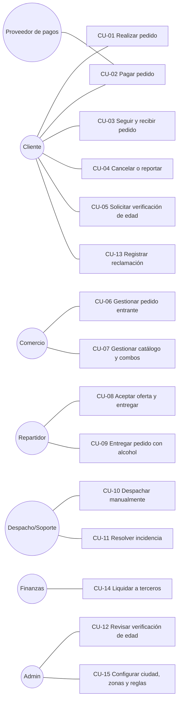

### 6.2 Especificaciones

#### CU-01 Realizar pedido
- **Actor principal:** Cliente.
- **Precondiciones:** sesión iniciada; al menos una dirección con punto confirmado.
- **Flujo principal:**
  1. El cliente elige ciudad y comercio y ve el catálogo visible para su estado de edad.
  2. Elige un producto, su variante, adicionales, opciones de combo, una nota y la cantidad, y lo agrega al carrito (`PUT /cart`). El servidor valida y recalcula.
  3. En el carrito elige dirección, inmediato o franja programada, medio de pago, propina opcional (sin preselección), cupón y datos del comprobante.
  4. El sistema cotiza (`POST /checkout/quotes`) y muestra el desglose, el total, la ETA y la versión con su vencimiento.
  5. Si hay alcohol, el sistema muestra los avisos legales y el cliente acepta las condiciones de entrega.
  6. El cliente confirma (`POST /orders` con `Idempotency-Key`).
  7. El sistema revalida todo, reserva stock, cupón, franja y cupo, y crea el pedido. Con efectivo queda `confirmado`; con pago digital queda `pendiente_confirmacion` (continúa en CU-02).
- **Flujos alternos:**
  - 2a. El carrito tiene productos de otro comercio → `CART_OTHER_BRANCH` → el cliente confirma el reemplazo.
  - 4a. Fuera de cobertura u otra ciudad → `OUT_OF_COVERAGE` / `CROSS_CITY`.
  - 4b. Comercio cerrado → `STORE_CLOSED` (puede programar).
  - 4c. Problemas de stock, combo o cupón → `CART_PROBLEMS` / `COUPON_INVALID`.
  - 4d. Alcohol no permitido → `AGE_RESTRICTED`, `ALCOHOL_OUTSIDE_HOURS`, `ALCOHOL_BLACKOUT`, `ALCOHOL_NO_RULES` o `ALCOHOL_PERMIT`.
  - 6a. La cotización cambió → `QUOTE_CHANGED` con la nueva versión → el cliente revisa y vuelve a confirmar.
  - 6b. Doble clic o reintento → el mismo pedido (`Idempotent-Replayed: true`).
  - 6c. Sin conexión → error de red; nada se crea; al reconectar el reintento crea un solo pedido.
  - 7a. Otro cliente se llevó la última unidad → `OUT_OF_STOCK` / `CART_PROBLEMS`.
- **Postcondiciones:** pedido creado con la fotografía de precios y componentes; reservas activas; evento `order.created`.

#### CU-02 Pagar pedido (digital)
- **Actores:** Cliente; Proveedor de pagos.
- **Precondiciones:** pedido `pendiente_confirmacion` con pago `pendiente` y dentro del plazo.
- **Flujo principal:**
  1. El cliente inicia el pago (`POST /payments`). En la web con Culqi, primero obtiene el token en el checkout del proveedor.
  2. El sistema crea un intento de pago único y llama al proveedor.
  3. El proveedor confirma por webhook. El sistema verifica la autenticidad, descarta duplicados y valida importe, moneda y referencia.
  4. El sistema marca el pago `pagado`, el pedido `confirmado`, fija el plazo de aceptación del comercio y registra el asiento de cobro.
- **Flujos alternos:**
  - 2a. Respuesta incierta → `en_conciliacion`; el job consulta al proveedor.
  - 3a. Rechazo → pago `fallido`; el pedido se cancela y libera stock.
  - 3b. El pago llega tarde, con el pedido ya vencido → devolución automática.
  - 3c. Importe distinto → `mismatch_needs_review`; pasa a conciliación y queda auditado.
  - 4a. Al pagar, el alcohol ya no está permitido → se cancela con reembolso.

#### CU-03 Seguir y recibir pedido
1. El cliente ve la cronología de los tres ciclos y la ETA.
2. Con el repartidor en camino, ve su última ubicación (con la marca "desactualizada" si tiene más de 2 minutos) y recibe el aviso de proximidad.
3. Al recibir el pedido, dicta el código de 4 dígitos.
4. Puede valorar el pedido completado.

#### CU-04 Cancelar o reportar
- **Cancelar:** solo en `pendiente_confirmacion` o `confirmado`. El sistema libera stock, revierte cupón y franja y reembolsa.
- **Reportar:** tipo de problema, descripción y evidencia opcional (imagen privada). Se genera una incidencia para soporte (CU-11).

#### CU-05 Solicitar verificación de edad
1. El cliente envía tipo de documento, últimos 4 caracteres, nombre según documento, fecha de nacimiento y consentimiento.
2. Si es menor de 18 años, el sistema rechaza y registra.
3. Si no, la solicitud queda `pending` (una sola a la vez) y continúa en CU-12.

#### CU-06 Gestionar pedido entrante (comercio)
1. El pedido aparece en la bandeja en tiempo real con su plazo de aceptación.
2. El comercio acepta (se revalidan las reglas de alcohol) o rechaza con motivo; un rechazo reembolsa.
3. Si falta un producto, propone retirarlo y espera la respuesta del cliente.
4. Inicia la preparación (salida definitiva de stock), ajusta la ETA si hace falta y marca **listo**.
5. Entrega al repartidor que presenta el código de recojo.
- **Alterno:** vence el plazo de aceptación → el sistema rechaza y reembolsa.
- **Devolución:** el comercio inspecciona y decide si los productos vuelven a stock vendible.

#### CU-07 Gestionar catálogo y combos
El comercio:
- Crea productos (preparados o con stock y unidad).
- Edita precios: aplican a nuevas compras, no a pedidos confirmados.
- Ajusta stock con motivo.
- Crea combos con componentes y variantes elegibles. El sistema deriva la restricción de alcohol y exige la habilitación.

#### CU-08 Aceptar oferta y entregar (sin alcohol)
1. El repartidor se conecta y comparte su ubicación.
2. Recibe una oferta (60 s) y la acepta. Si otro la tomó, el sistema responde `OFFER_UNAVAILABLE` o `ALREADY_ASSIGNED`.
3. Se dirige al comercio y confirma el recojo con el código y los paquetes.
4. Sale hacia el cliente y marca "en destino".
5. Ingresa el código de entrega y, si es efectivo, el monto cobrado.
6. El sistema completa el pedido y registra los asientos contables.
- **Alternos:** cliente ausente, dirección incorrecta, accidente o avería → entrega fallida → retorno al comercio e incidencia. Liberar el pedido antes del recojo → nueva oferta.

#### CU-09 Entregar pedido con alcohol
Igual a CU-08 hasta llegar a destino. Luego:
1. El estado pasa a `verificacion_requerida`.
2. El repartidor pide el documento oficial, comprueba que la persona es el comprador y tiene 18 años, y registra el resultado sin fotografiar el documento.
3. Si aprueba, ingresa el código de entrega y completa.
4. Si rechaza (sin documento, no coincide, menor, no es el comprador, intoxicación o riesgo) → `entrega_rechazada` → retorno; incidencia con la resolución sugerida.
- Sin conexión no se entrega.
- Fuera del horario permitido no se entrega.

#### CU-10 Despachar manualmente
1. El despachador de la ciudad filtra los pedidos sin repartidor.
2. Elige un repartidor aprobado de la ciudad (capacitado si hay alcohol) e indica el motivo.
3. El sistema cancela la oferta abierta, revalida la cobertura y asigna de forma atómica.
- **Reasignar:** solo antes del recojo.

#### CU-11 Resolver incidencia
1. Soporte revisa la incidencia, la evidencia (enlace de 5 min) y el detalle financiero del pedido.
2. Registra la resolución y, si corresponde, un reembolso por concepto (productos, reparto, propina, servicio).
3. El reembolso se ejecuta con el proveedor.

#### CU-12 Revisar verificación de edad
1. El administrador (distinto del solicitante) realiza la revisión según el procedimiento (videollamada o presencial).
2. Aprueba o rechaza con método y motivo; el sistema impide aprobar a un menor.
3. Puede revocar una verificación aprobada.

#### CU-13 Registrar reclamación
1. Cualquier persona, con o sin sesión, completa la hoja.
2. El sistema asigna un número correlativo, calcula el vencimiento y muestra la constancia (copia por correo [pendiente]).
3. Soporte responde antes del vencimiento.
4. El consumidor consulta su reclamación con número y correo.

#### CU-14 Liquidar a terceros
1. Finanzas genera la liquidación de un comercio o repartidor por período.
2. Otra persona de finanzas la aprueba; el sistema verifica que el total recalculado coincide.
3. La transferencia se hace fuera de la plataforma y se registra su referencia (`executed`).
- **Alterno:** anular antes de ejecutar libera los movimientos.

#### CU-15 Configurar ciudad, zonas y reglas
El administrador puede:
- Editar polígonos (nueva versión) y registrar tarifas.
- Registrar ventanas de alcohol con fuente, fecha y responsable, y prohibiciones temporales.
- Pausar la ciudad o suspender zonas.
- Habilitar alcohol en la ciudad: solo es efectivo si existen reglas validadas.

---

## 7. Procesos y diagramas de secuencia

### 7.1 Pedido con pago digital

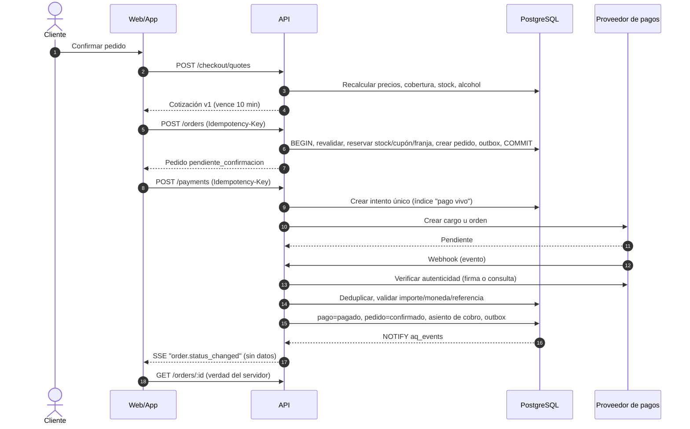

### 7.2 Despacho con aceptación atómica

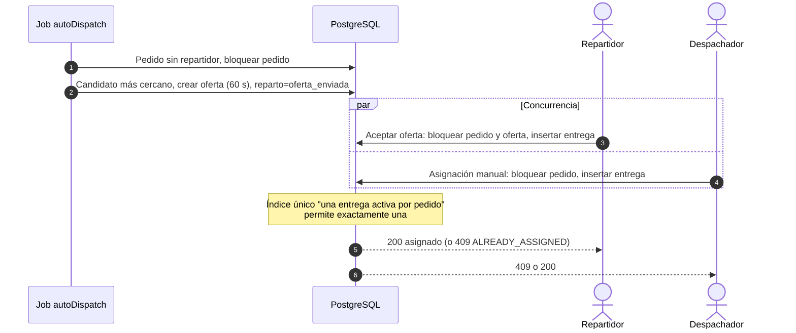

### 7.3 Entrega con alcohol

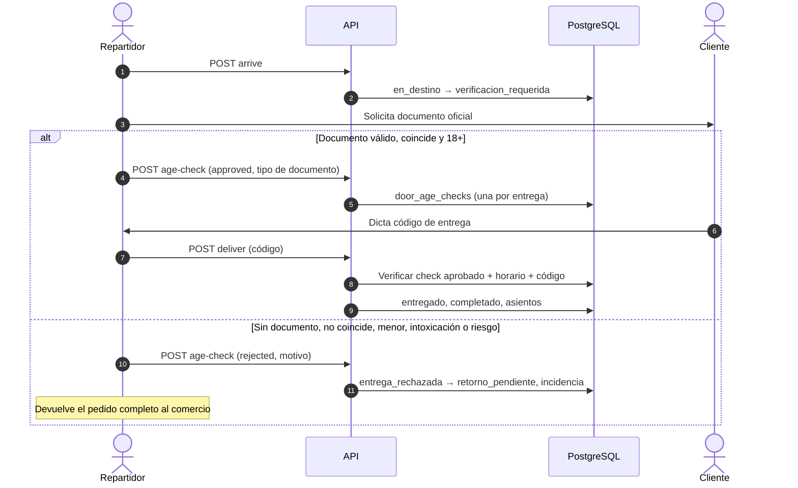

### 7.4 Vencimiento y conciliación de pagos

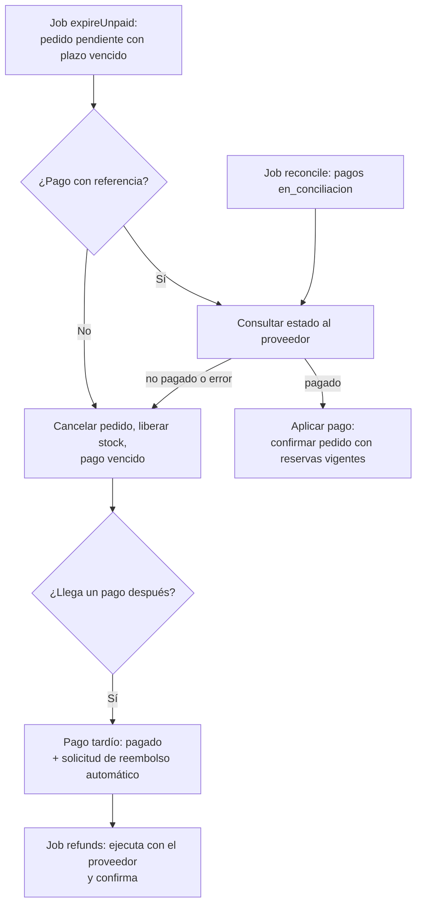

### 7.5 Liquidación con cuatro ojos

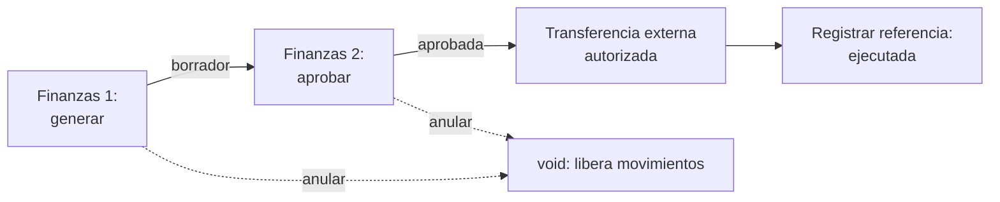

---

## 8. Ciclos de vida (diagramas de estado)

El sistema maneja **tres ciclos independientes** por pedido. La tabla completa de transiciones,
con actores, precondiciones y efectos, está en `estados.md`, generada desde el código.

### 8.1 Ciclo comercial

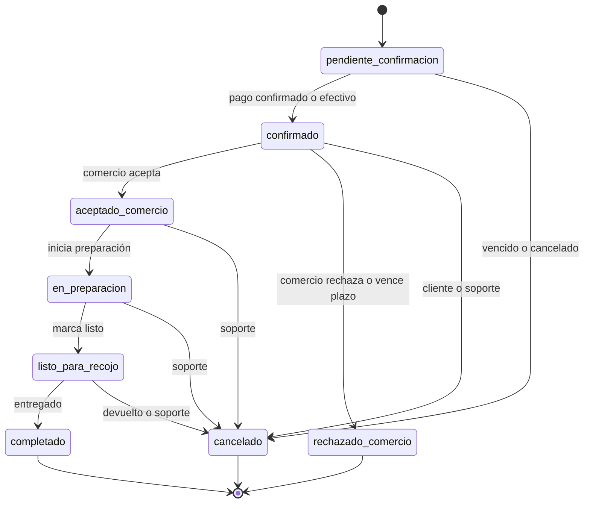

### 8.2 Ciclo de reparto

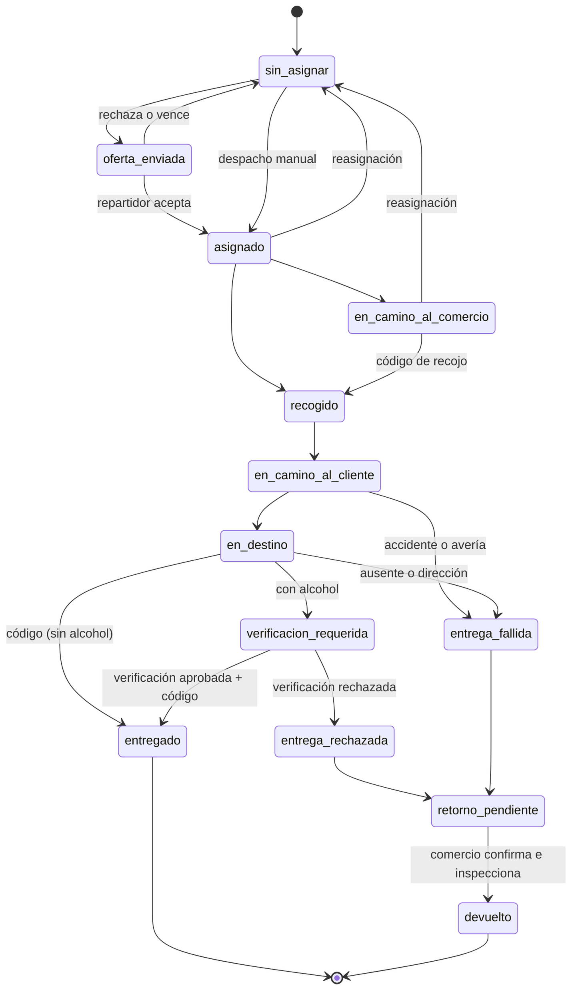

### 8.3 Ciclo de pago

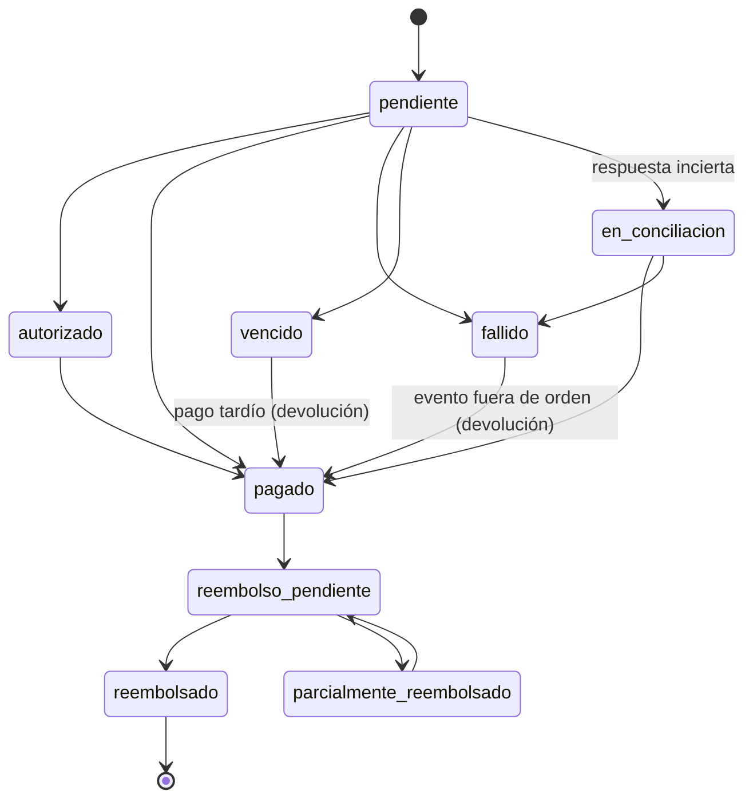

### 8.4 Otros ciclos

| Entidad | Estados |
|---|---|
| Verificación de edad | `pending` → `verified` / `rejected`; `verified` → `revoked` (manual o por cambio de identidad) |
| Comercio | `pending` → `approved` / `rejected`; `suspended` |
| Habilitación de alcohol (sucursal) | `none` → `approved` (con documento vigente) → `expired` (job) / `suspended` |
| Documento | `pending` → `approved` / `rejected`; `approved` → `expired` (job) |
| Repartidor | `pending` → `approved` / `rejected`; `suspended` |
| Oferta | `offered` → `accepted` / `rejected` / `expired` / `cancelled` |
| Reembolso | `pending` → `succeeded` / `failed`; `not_required` (nunca se cobró) |
| Liquidación | `draft` → `approved` → `executed`; `draft` o `approved` → `void` |
| Reclamación | pendiente → respondida (`response`, `responded_at`) |
| Evento outbox | pendiente → procesado; reintentos con espera exponencial → `dead_at` tras 8 intentos |

---

## 9. Modelo de datos

**Motor:** PostgreSQL 16 + PostGIS 3.4. 74 tablas en 2 migraciones (`apps/api/migrations`).

**Convenciones:**
- Claves `uuid`; importes en `bigint` (céntimos de PEN); instantes en `timestamptz` (UTC).
- Geometrías en SRID 4326.
- Los invariantes críticos se protegen con `CHECK`, índices únicos (parciales) y triggers.

### 9.1 Diagrama entidad-relación (núcleo)

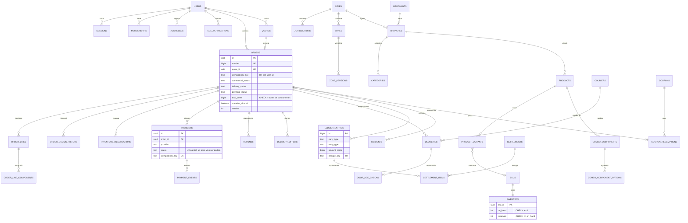

### 9.2 Catálogo de tablas por dominio

| Dominio | Tablas |
|---|---|
| Identidad | `users`, `sessions`, `otp_challenges`, `password_resets`, `mfa_totp`, `login_attempts`, `memberships`, `consents`, `data_requests`, `push_tokens` |
| Geografía | `cities`, `jurisdictions`, `zones`, `zone_versions`, `zone_suspensions`, `addresses`, `delivery_fee_rules`, `peru_holidays` |
| Comercio y catálogo | `merchants`, `branches`, `branch_hours`, `branch_closures`, `documents`, `categories`, `products`, `product_variants`, `modifier_groups`, `modifier_options`, `combo_components`, `combo_component_options`, `skus`, `inventory`, `favorites`, vista `v_product_restriction` |
| Alcohol | `age_verifications`, `alcohol_rules`, `alcohol_blackouts`, `door_age_checks`, `courier_trainings` |
| Pedidos | `carts`, `quotes`, `orders`, `order_lines`, `order_line_components`, `order_status_history`, `substitutions`, `scheduled_slot_bookings`, `inventory_reservations`, `inventory_movements`, `delivery_code_attempts`, `order_nearby_notices` |
| Despacho | `couriers`, `courier_locations`, `delivery_offers`, `deliveries` |
| Pagos y finanzas | `payments`, `payment_events`, `refunds`, `cash_collections`, `commission_rules`, `coupons`, `coupon_redemptions`, `ledger_entries`, `settlements`, `settlement_items`, `sandbox_provider_charges` (solo desarrollo) |
| Soporte | `order_messages`, `incidents`, `ratings`, `complaints`, `complaint_counters` |
| Plataforma | `notifications`, `outbox_events`, `audit_log`, `banners`, `app_settings`, `schema_migrations` |

### 9.3 Diccionario de datos: entidades críticas

**`orders`**: pedido; guarda la fotografía económica al confirmar.

| Columna | Tipo | Regla |
|---|---|---|
| `number` | bigint | Correlativo visible (secuencia desde 1001), único. |
| `code` | text | Código alfanumérico único. |
| `quote_id` | uuid | Único: una cotización, un pedido. |
| `idempotency_key` | text | Único junto con `user_id`. |
| `destination` | geometry(Point) | Punto confirmado de entrega. |
| `destination_jurisdiction_id`, `destination_zone_id` | uuid | Resultado de la cobertura al confirmar. |
| `commercial_status`, `delivery_status`, `payment_status` | text | Ciclos independientes (sección 8). |
| `subtotal_cents`, `discount_cents`, `delivery_fee_cents`, `service_fee_cents`, `surcharge_cents`, `tip_cents`, `total_cents` | bigint | `CHECK total = subtotal − descuento + envío + servicio + recargo + propina`. |
| `refunded_cents` | bigint | `CHECK ≤ total`. |
| `courier_pay_cents` | bigint | Pago al repartidor fijado en la cotización. |
| `coupon_funded_by` | text | `platform` / `merchant` (afecta los asientos). |
| `contains_alcohol`, `minimum_age`, `alcohol_terms_accepted_at` | | Restricción y aceptación previa al pago. |
| `pickup_code` | text | 6 dígitos; lo ve solo el comercio. |
| `delivery_code_hash`, `delivery_code_enc` | text | SHA-256 para validar; AES-256-GCM para mostrarlo al comprador. |
| `accept_deadline`, `payment_deadline`, `eta_at` | timestamptz | Plazos que controlan los jobs. |
| `version` | int | Se incrementa en cada transición (concurrencia optimista e historial). |

**`inventory`** / **`inventory_reservations`** / **`inventory_movements`**
- `inventory.on_hand ≥ 0`, `reserved ≥ 0`, `reserved ≤ on_hand`.
- La reserva se hace con `UPDATE … WHERE on_hand − reserved ≥ q`.
- Reservas: `UNIQUE (order_id, sku_id)`, estados `active` / `released` / `committed` y vencimiento ligado al plazo de pago.
- Movimientos: `reserve`, `release`, `commit`, `restock`, `adjust`, `return_restock`, `return_discard`, con saldos posteriores y actor.

**`payments`** / **`payment_events`** / **`refunds`**
- `payments`: índice único parcial "un pago vivo por pedido"; `idempotency_key` único; `(provider, provider_reference)` único.
- `payment_events`: `UNIQUE (provider, provider_event_id)` (deduplicación); `verified`, `verification_note`, `outcome`.
- `refunds`: `idempotency_key` único; `concept` (`products`, `delivery`, `tip`, `service`, `mixed`); `status` confirmado solo por el proveedor o, para efectivo y transferencia, de forma manual.

**`ledger_entries`** / **`settlements`** / **`settlement_items`**
- Libro inmutable (trigger `forbid_mutation`); `dedupe_key` único (un mismo hecho no se registra dos veces).
- `party_type`: `platform`, `merchant`, `courier`, `customer`, `gateway`.
- `settlement_items.ledger_entry_id` único: un movimiento solo puede estar en una liquidación vigente.
- `settlements`: único por (tercero, período) salvo las anuladas.

**`age_verifications`** / **`door_age_checks`**
- Verificación: `status`, `document_type`, `document_last4` (nunca el número completo), `birth_date`, `method`, `policy_version`, `reviewer_id`, `decision_reason`; una sola `pending` por usuario.
- Puerta: una por entrega; `CHECK`: aprobada exige `identity_matches_buyer` y tipo de documento; rechazada exige motivo.

**`deliveries`** / **`delivery_offers`**
- Únicos parciales: una oferta `offered` por pedido y por repartidor; una entrega `active` por pedido y por repartidor.

**`audit_log`**: inmutable; actor, roles, acción, entidad, motivo, datos y `correlation_id`.

---

## 10. Matriz de permisos

Leyenda:
- ✔: permitido.
- ◐: permitido dentro de su ámbito (ciudad, comercio, sucursal o lo propio).
- —: no permitido.

🔐 = exige TOTP verificado cuando el usuario accede **solo** con los roles admin o finanzas.

| Acción | Cliente | Propietario | Operador | Repartidor | Despacho | Soporte | Finanzas 🔐 | Admin 🔐 |
|---|---|---|---|---|---|---|---|---|
| Catálogo, carrito, cotizar, pedir, pagar, seguir | ◐ (propio) | ◐ | ◐ | ◐ | ◐ | ◐ | ◐ | ◐ |
| Solicitar verificación de edad | ◐ | ◐ | ◐ | ◐ | ◐ | ◐ | ◐ | ◐ |
| Postular comercio o repartidor | ✔ | ✔ | ✔ | ✔ | ✔ | ✔ | ✔ | ✔ |
| Bandeja y acciones sobre pedidos de la sucursal | — | ◐ comercio | ◐ sucursal | — | — | — | — | — |
| Catálogo, stock, combos, horarios, pausa | — | ◐ | ◐ | — | — | — | — | — |
| Invitar operadores, subir documentos del comercio | — | ◐ | — | — | — | — | — | — |
| Ofertas, entrega, verificación en puerta | — | — | — | ◐ asignados | — | — | — | — |
| Tablero y pedidos (lectura) | — | — | — | — | ◐ ciudad | ✔/◐ | ✔ | ✔ |
| Asignar o reasignar | — | — | — | — | ◐ ciudad | — | — | ✔ |
| Cancelar pedido (supervisado) | — | — | — | — | ◐ | ✔/◐ | — | ✔ |
| Aprobar repartidores | — | — | — | — | ◐ ciudad | — | — | ✔ |
| Suspender zona | — | — | — | — | ◐ ciudad | — | — | ✔ |
| Solicitar reembolso | — | — | — | — | — | ✔/◐ | ✔ | ✔ |
| Resolver incidencias, responder reclamaciones | — | — | — | — | — | ✔ | — | ✔ |
| Cola de edad: ver / decidir | — | — | — | — | — | ver | — | ver y decidir |
| Conciliar pagos | — | — | — | — | — | — | ✔ | ✔ |
| Confirmar transferencia o reembolso manual | — | — | — | — | — | — | ✔ | — |
| Generar, aprobar, ejecutar o anular liquidaciones | — | — | — | — | — | — | ✔ | (lectura) |
| Rendición de efectivo | — | — | — | — | ver ◐ | — | ✔ | ver |
| Comisiones | — | — | — | — | — | — | ✔ | ✔ |
| Comercios, documentos, permiso de alcohol | — | — | — | — | ver ◐ | ver | — | ✔ |
| Ciudades, zonas (versiones), tarifas, reglas de alcohol | — | — | — | — | tarifas (ver) | — | — | ✔ |
| Cupones (crear) / banners | — | — | — | — | — | — | ver cupones | ✔ |
| Roles, datos personales (ARCO), auditoría, outbox, métricas | — | — | — | — | — | — | — | ✔ |
| Exportación CSV global | — | — | — | — | — | — | ✔ | ✔ |

**Reglas transversales:**
- La identidad y los roles salen de la sesión validada, nunca de campos enviados por el cliente.
- El acceso a recursos fuera de ámbito responde **404**, sin revelar que existen.
- Un revisor no puede decidir su propia verificación de edad, aprobar su propia liquidación ni revocar su propio rol de administrador.

---

## 11. Arquitectura

### 11.1 Componentes

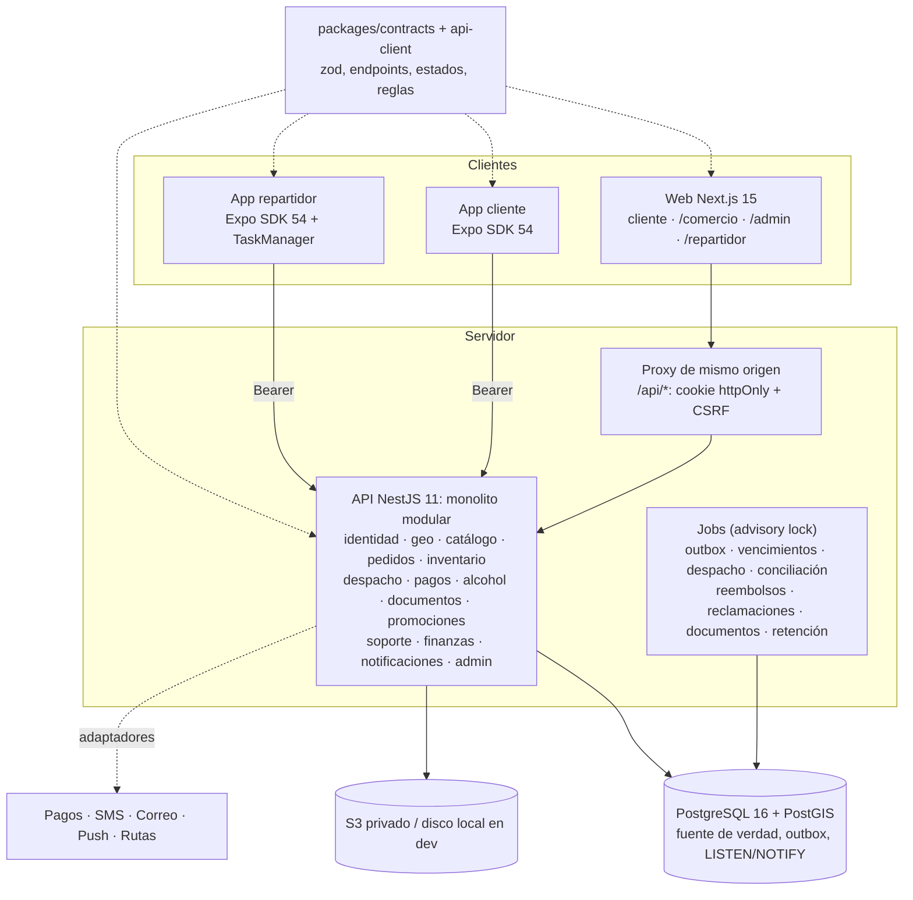

### 11.2 Decisiones de arquitectura principales
(ver `decisiones.md` T1–T24)
- **Monolito modular** en lugar de microservicios.
- **SQL explícito** en lugar de ORM, por las garantías de concurrencia.
- **PostgreSQL como cola** (outbox con `SKIP LOCKED`) en lugar de Redis.
- **SSE** con eventos mínimos y relectura de la API.
- **Contratos zod únicos** compartidos por API, web y móvil.
- **Adaptadores intercambiables** para cada tercero, con simuladores solo en desarrollo.

### 11.3 Despliegue
- Contenedores (`infra/Dockerfile.api`, `infra/Dockerfile.web`).
- `docker-compose.yml` para desarrollo: PostGIS + MinIO + API + web.
- CI en GitHub Actions: instalación, compilación, tipos, pruebas unitarias e integración con PostGIS, build web, E2E con Playwright, bundle Android y ensayo de restauración.
- Entornos y procedimiento de despliegue, reversión y monitoreo: `despliegue.md`.

---

## 12. Interfaces y eventos

### 12.1 API REST
- 165 operaciones (151 rutas) documentadas en `openapi.json`, generado desde `packages/contracts/src/endpoints.ts`. Una prueba garantiza que coinciden con las rutas reales.

| Grupo | Operaciones | Ejemplos |
|---|---|---|
| auth | 11 | `/auth/login`, `/auth/otp/*`, `/auth/mfa/*`, `/auth/sessions` |
| me | 15 | `/me`, `/me/addresses`, `/me/consents`, `/me/data-requests`, `/notifications` |
| geo | 4 | `/cities`, `/cities/:id/zones`, `/coverage/check` |
| catálogo | 5 | `/stores`, `/stores/:id`, `/products/:id`, `/search`, `/banners` |
| pedidos | 14 | `/cart`, `/checkout/quotes`, `/orders`, `/orders/:id/cancel`, `/orders/:id/tracking` |
| pagos | 4 (+1 dev) | `/payments`, `/payments/config`, `/webhooks/payments/:provider` |
| edad | 2 | `/age-verifications`, `/age-verifications/me` |
| comercio | 23 | `/merchant/branches/:id/orders`, `/merchant/orders/:id/accept`, `/merchant/branches/:id/combos` |
| repartidor | 19 | `/courier/offers/:id/accept`, `/courier/deliveries/:orderId/deliver` |
| admin | 56 | `/admin/orders/:id/assign`, `/admin/settlements/:id/approve`, `/admin/zones/:id/versions` |
| soporte, reclamaciones, archivos, ops | 3 + 2 + 3 + 2 | `/orders/:id/incidents`, `/complaints`, `/files`, `/health`, `/metrics` |

**Convenciones:**
- Errores con código estable (`{ error: { code, message, details }, correlationId }`).
- 4xx para negocio y validación; 5xx para fallas técnicas.
- `Idempotency-Key` obligatorio en pedidos, pagos, reembolsos y liquidaciones.

### 12.2 Eventos del outbox
Se escriben en la misma transacción que el cambio y se procesan con reintentos.

| Evento | Efecto |
|---|---|
| `order.created`, `order.status_changed`, `order.cancelled`, `order.eta_changed` | Notificaciones al cliente, comercio y repartidor; SSE a los canales del usuario, sucursal y ciudad. |
| `offer.created` | Notificación al repartidor. |
| `substitution.proposed` / `.responded` | Aviso al cliente o al comercio. |
| `order.message` | SSE a los participantes. |
| `courier.nearby` | "Tu repartidor está cerca" (una vez por pedido). |
| `incident.created` / `.resolved` | SSE a operaciones. |
| `refund.requested` / `.confirmed` | Ejecución y aviso del reembolso. |
| `age_verification.decided` | Aviso al usuario. |
| `courier.reviewed` | Aviso al postulante. |
| `complaint.created` / `.due_soon` | Aviso a soporte y administración. |
| `branch.alcohol_permit_expired` | Aviso al propietario. |

**Tiempo real:**
- Canales `user:<id>`, `branch:<id>`, `city:<id>` / `city:*`.
- La carga útil es solo `{type, orderId, version, at}`: nunca datos personales ni ubicación.

### 12.3 Interfaces con terceros (adaptadores)

| Interfaz | Implementaciones | Estado |
|---|---|---|
| `PaymentProvider` (crear, consultar, verificar webhook, reembolsar) | `SandboxProvider` (dev), `CulqiProvider` | Culqi: B |
| `SmsProvider` | `console` (dev), `TwilioSms` | B |
| `EmailProvider` | `console` (dev) | P (proveedor real) |
| Push | Expo Push | B |
| Rutas | Haversine (aproximación), OSRM | OSRM: B |
| `StorageAdapter` | Local (dev), S3 | S3: B |
| Facturación | — | P |

---

## 13. Inventario de pantallas

| Módulo | Pantalla | Ruta o ubicación |
|---|---|---|
| Cliente web | Inicio (ciudad, dirección, banners, categorías, comercios) | `/` |
| | Tienda y ficha de producto (variantes, adicionales, combos, nota) | `/tienda/[id]` |
| | Carrito y checkout (dirección, franja, pago, propina, cupón, comprobante, avisos de alcohol) | `/carrito` |
| | Mis pedidos / Detalle (pago, faltantes, seguimiento con mapa, código, cronología, mensajes, incidencia, valoración) | `/pedidos`, `/pedidos/[id]` |
| | Buscar | `/buscar` |
| | Cuenta (acceso, TOTP, direcciones con mapa, edad, favoritos, notificaciones, consentimientos, ARCO, sesiones) | `/cuenta` |
| | Libro de Reclamaciones | `/reclamaciones` |
| | Términos y privacidad (borradores) | `/legal` |
| | Alta de comercio / Postulación de repartidor | `/comercio/alta`, `/repartidor/postular` |
| Comercio | Pedidos (en curso, historial, comanda, faltantes, devoluciones) · Catálogo y stock · Combos · Horarios, cierres, pausa, operadores · Ventas y liquidaciones · Documentos | `/comercio` (pestañas) |
| Repartidor web | Disponibilidad, ofertas, entrega activa, verificación en puerta, ingresos, documentos | `/repartidor` |
| Administración | Indicadores · Pedidos y despacho · Repartidores · Comercios · Documentos · Verificación de edad · Ciudades, zonas, tarifas y alcohol · Cupones · Banners · Finanzas · Incidencias y reclamaciones · Datos personales · Roles · Auditoría y eventos | `/admin` (pestañas) |
| App cliente | Acceso · Inicio con banners · Tienda y ficha · Carrito · Pedidos y detalle con mapa · Cuenta (dirección con mapa, edad, notificaciones) | `apps/customer-mobile` |
| App repartidor | Acceso · Disponibilidad y ubicación · Ofertas · Entrega activa con mapa y verificación de edad · Ingresos | `apps/courier-mobile` |

**Estados de interfaz cubiertos:** carga, vacío, error con reintento, sin conexión, comercio cerrado, agotado, fuera de cobertura, pago pendiente o en conciliación y simulador de desarrollo marcado.

---

## 14. Seguridad, privacidad y auditoría

| Aspecto | Medida |
|---|---|
| Autenticación | scrypt; sesiones opacas (hash SHA-256) revocables; TTL de 30 días (12 h para roles sensibles); OTP con límites; TOTP con anti-reutilización. |
| Autorización | Guard global por rol, más ámbito en cada servicio; 404 fuera de ámbito; 4 ojos en edad y liquidaciones. |
| Web | Cookie httpOnly SameSite=Lax + CSRF de doble envío; cabeceras de seguridad; proxy de mismo origen. |
| Móvil | Token en SecureStore (Keystore/Keychain). |
| Entradas | Validación zod en el servidor; SQL siempre parametrizado; archivos validados por firma de bytes, máx. 5 MB, titularidad verificada. |
| Datos sensibles | Código de entrega cifrado (AES-256-GCM); documento de identidad solo con últimos 4 caracteres; sin fotos de DNI por defecto; enlaces de archivo firmados de 5 min. |
| Logs | Redacción de claves sensibles (tokens, teléfono, correo, coordenadas, documentos); `correlationId`. |
| Ubicación | Solo la última posición; visible al cliente solo durante el tramo activo; se borra al desconectarse (job de retención). |
| Pagos | Sin números de tarjeta en el servidor (token del proveedor); webhooks verificados; idempotencia. |
| Auditoría | `audit_log` inmutable para cambios críticos con motivo; libro contable inmutable. |
| Configuración | Producción rechaza simuladores, demo y claves faltantes. |
| Privacidad | Consentimientos versionados por finalidad; ARCO con plazos; eliminación por anonimización conservando registros obligatorios; marketing de alcohol solo a verificados con consentimiento. |

---

## 15. Calidad y verificación

- **73 pruebas automatizadas:**
  - 10 unitarias (reglas puras).
  - 58 de API: 50 de aceptación contra PostgreSQL real, 7 de adaptadores contra un servidor simulado, 1 del registro de rutas.
  - 5 E2E en navegador.
- **Evidencias adicionales:** ensayo de restauración; prueba de carga local; bundles Android; CI en verde.
- **Trazabilidad requisito → pantalla → endpoint → entidad → prueba:** `trazabilidad.md`.
- **Resultados, entorno y limitaciones:** `informe-pruebas.md`.
- **Lo pendiente:** `PENDIENTES.md`.

---

## 16. Glosario

| Término | Definición |
|---|---|
| Cotización | Cálculo del pedido con identificador, versión y vencimiento; el cliente acepta una versión concreta. |
| Fotografía lógica | Copia de precios, descuentos y componentes al confirmar; los cambios posteriores del catálogo no la alteran. |
| SKU | Unidad física inventariable (p. ej. "lata 355 ml"); lleva la marca de alcohol y la edad mínima. |
| Reserva | Stock apartado para un pedido no preparado; se libera o se convierte en salida. |
| Pago vivo | Intento de pago no fallido ni vencido; como máximo uno por pedido. |
| Conciliación | Consulta al proveedor para resolver un resultado incierto o pendiente. |
| Outbox | Tabla de eventos escrita en la misma transacción que el cambio; garantiza notificaciones sin pérdida. |
| Jurisdicción | Distrito municipal cuya normativa aplica (p. ej. horarios de alcohol). |
| Zona | Polígono de reparto de una ciudad, versionado. |
| Verificación presencial | Comprobación de documento, identidad y edad por el repartidor en la entrega de alcohol. |
| Cuatro ojos | Control que exige dos personas distintas (generar y aprobar). |
| Liquidación | Orden reproducible de pago a un comercio o repartidor por un período, basada en el libro. |
| ARCO | Derechos de acceso, rectificación, cancelación y oposición sobre datos personales. |
| TOTP | Código temporal de 6 dígitos de una app autenticadora (RFC 6238). |
| SSE | *Server-Sent Events*: canal del servidor al navegador para avisos en tiempo real. |
| PITR | Recuperación de la base de datos a un punto en el tiempo. |
